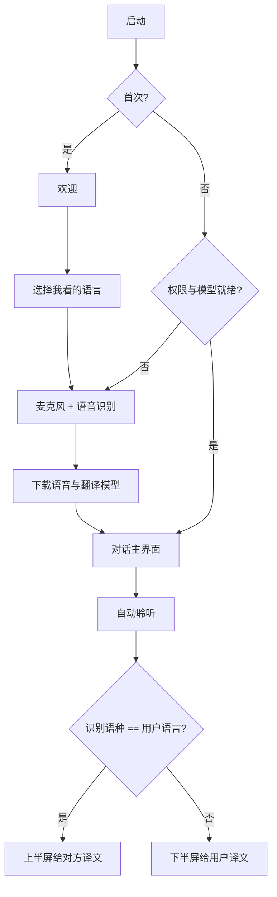

# 01 产品原型设计

产品名：**对译 Duiyi**
形态：iPhone 原生 App，竖屏锁定，桌面平放使用
核心承诺：只懂中文的人，和只懂英文的人，面对面流畅交流

可交互界面：[`../prototype/index.html`](../prototype/index.html)
布局图：[`diagrams/screen-layout.svg`](diagrams/screen-layout.svg)

---

## 1. 使用场景

两人隔桌相对。手机屏幕朝上，平放在桌子正中。

```
        对方（只懂英文或只懂中文）
                    │
                    ▼
        ┌─────────────────────┐
        │   上半屏 · 倒字     │  ← 对方低头看到的是正字
        │                     │
        │      ● 聆听中       │
        │                     │
        │   下半屏 · 正字     │  ← 用户看到的是正字
        └─────────────────────┘
                    ▲
                    │
        用户（只懂中文或只懂英文）
```

约束：

- 距离约 40–80 cm，必须用大字号、高对比。
- 手机正面朝上时系统方向不可靠，**锁定竖屏**，不以重力翻转布局。
- 底部麦克风更靠近用户。这是物理事实，不在 v1 用软件「对准谁」；靠系统多麦克风拾音与 SpeechAnalyzer 的远场模型。

---

## 2. 产品规则（字幕怎么走）

每一侧屏幕只给「正在看这一侧的人」看译文。说话人已经知道自己说了什么，不需要在自己面前放大原文。

| 谁在说 | 说的语种 | 用户屏（下，正字） | 对方屏（上，倒字） |
| --- | --- | --- | --- |
| 对方 | 英文 | **中文译文** | 轻提示：正在说… |
| 对方 | 中文 | **英文译文** | 轻提示：正在说… |
| 用户 | 英文 | 轻提示：正在说… | **中文译文** |
| 用户 | 中文 | 轻提示：正在说… | **英文译文** |

单麦克风无法稳定做说话人分离。v1 用 **语种作为路由键**：

1. 用户在首次使用时选定「我看的语言」（中文或英文）。
2. 对侧自动是另一种语言。
3. 识别到的语种 = 用户语言 → 译文打到**上半屏**（给对方）。
4. 识别到的语种 = 对方语言 → 译文打到**下半屏**（给用户）。

这四条需求因此被同一套规则覆盖，无需手动切换「当前是谁在说」。

默认语言：跟系统首选语言。`zh*` → 用户看中文；否则用户看英文。主界面提供一键对调。

---

## 3. 信息架构

页面极少。对话是产品，其余都是进入对话的台阶。

```
启动
  ├─ 首次：欢迎 → 选择「我看的语言」→ 权限 → 下载模型 → 对话
  └─ 再次：直接进入对话（模型已就绪则自动可听）

对话（唯一主界面）
  ├─ 上半屏：给对方的字幕（旋转 180°）
  ├─ 中央：开始 / 暂停
  ├─ 下半屏：给用户的字幕
  └─ 长按中央：设置（语言对调、字号、清屏）

设置（半屏卡片，不离开对话）
  ├─ 我看中文 / 我看英文
  ├─ 字幕字号
  ├─ 清屏
  └─ 重新下载语言模型
```

不进 v1 的能力（刻意砍掉）：历史会话列表、账号、云翻译、TTS 朗读、多语种、横屏、Apple Watch。



---

## 4. 关键界面

### 4.1 欢迎

一屏，一句人话，一个按钮。

- 标题：对译
- 副标题：把手机平放在中间，对面就能看懂你说的话
- 示意图：桌子 + 倒字 / 正字
- 主按钮：开始

### 4.2 选择语言

- 「你看哪种语言？」
- 两个大卡片：**中文** / **English**
- 辅助句：另一侧会自动显示另一种语言
- 可跳过：使用系统语言

### 4.3 权限

一次说清要什么、为什么：

- 麦克风：听见你们说的话
- 语音识别：在本机转成文字

拒绝时给「去设置」入口，不把用户卡死在空白屏。

### 4.4 模型准备

中英语音模型 + 中英翻译模型都是系统级、可离线的。第一次需要下载。

- 进度：语音模型、翻译模型 分两行
- 文案：下载只需一次，之后可完全离线使用
- 失败：重试；不自动反复弹系统授权框

### 4.5 对话主界面（核心）

竖向对半。中间一条控制带。

```
┌─────────────────────────────┐
│           对方侧              │  rotation: 180°
│  EN                         │
│                             │
│   I'd like a cup of coffee. │  ← 当前句，最大字
│                             │
│   See you at 3.             │  ← 上一句，降低对比
└─────────────────────────────┘
            ( ● )
          聆听中
┌─────────────────────────────┐
│  ZH                         │
│                             │
│   我想点一杯咖啡。            │
│                             │
│   三点见。                   │
└─────────────────────────────┘
```

状态：

| 状态 | 中央 | 两侧字幕 |
| --- | --- | --- |
| 空闲 | 麦克风空心，文案「轻点开始」 | 短引导句，低对比 |
| 聆听 | 呼吸灯 + 「聆听中」 | 等待下一句 |
| 单边在说 | 波形 | 听者侧滚动出译文；说者侧显示「正在说…」 |
| 暂停 | 实心麦克风 | 冻结最后一句 |
| 权限/模型异常 | 警告点 | 下半屏用正字说明原因（只给用户看） |

倒字实现：对方容器 `.rotationEffect(.degrees(180))`，布局仍按正常坐标系写，避免手写镜像字形。

### 4.6 设置卡片

从中央按钮长按弹出，贴在下半屏上方，避免挡住对方正在看的字。

- 语言对调（带动画，两侧徽章互换）
- 字号：标准 / 更大 / 最大（默认「更大」，按桌距设计）
- 清屏
- 完成

---

## 5. 交互细则

### 开始 / 暂停

- 主路径只有这一个按钮。
- 首次引导走完后，**自动进入聆听**，减少桌面上的操作。
- 再次打开 App：若权限与模型都就绪，同样自动聆听；用户可在设置关掉自动开始。

### 实时感

1. 语音中间结果（volatile）：听者侧先出浅色译文，250–400 ms 防抖后再送翻译，避免每字打一次模型。
2. 一句结束（final + 静音）：译文加实，字重从 Regular 收到 Semibold，并成为「上一句」。
3. 两侧同时说话：先完成的一句锁定；另一句进入队列。v1 不做真正的双讲混音分离。

### 清屏 / 对调

- 清屏只清字幕，不停聆听。
- 对调语言时，当前未完成的一句丢弃，避免打到错误的一侧。

### 熄屏

对话进行中 `isIdleTimerDisabled = true`。暂停 30 秒后恢复系统自动锁，避免把手机忘在桌上耗电。

### 误触

平放时手容易碰到屏幕。

- 控制热区集中在中线圆形按钮（直径 64 pt，外圈 88 pt 点按区）。
- 字幕区域不响应普通点按。
- 设置用长按，避免误开。

---

## 6. 视觉规范

桌面场景：环境光杂、有反光。深色底 + 暖白字，比纯黑白更耐看。

### 颜色

| Token | Hex | 用途 |
| --- | --- | --- |
| `bg.canvas` | `#12141A` | 全屏底 |
| `bg.user` | `#161920` | 用户侧 |
| `bg.peer` | `#1A1714` | 对方侧，略暖，倒过来也能区分「这是我的一半」 |
| `text.primary` | `#F4EFE6` | 当前字幕 |
| `text.secondary` | `#F4EFE6` 58% | 上一句、提示 |
| `accent.listen` | `#E8B86D` | 聆听、主按钮 |
| `lang.zh` | `#E8B86D` | 中文徽章 |
| `lang.en` | `#7EC8C3` | 英文徽章 |
| `danger` | `#E07070` | 权限失败 |

禁止大面积渐变、霓虹描边、调试面板。主界面不是「AI 产品发布页」，是一块给两个人看的字幕板。

### 字体

系统 SF / PingFang。不嵌入第三方字体，减少体积、保证中英混排。

| 角色 | 字号 | 字重 |
| --- | --- | --- |
| 当前字幕（默认「更大」） | 34 pt | Semibold |
| 当前字幕（最大） | 44 pt | Semibold |
| 上一句 | 20 pt | Regular |
| 徽章 / 状态 | 13 pt | Medium |
| 中央按钮标签 | 15 pt | Medium |

行距 1.25。最多同时展示：当前 1 句 + 上一句 1 句。更早的丢掉，避免桌面上字墙。

### 动效

- 新句：淡入 + 4 pt 上移，180 ms。
- 中间结果：无位移，只改文字，避免头晕。
- 倒字侧与正字侧用同一套动效（旋转加在容器上）。
- 降低动态：跟随系统 `AccessibilityReduceMotion`。

### 布局度量

- 安全区：顶部状态栏压暗，不侵入字幕。
- 上下各 48% 高度；中线控制带 72 pt，圆形按钮骑在分割线上。
- 左右内边距 22 pt。
- 圆角只出现在设置卡片，主字幕区直角或大半径 0，更像一块板。

---

## 7. 无障碍与本地化

- VoiceOver 只服务用户侧（下半屏）。倒字侧不进无障碍树，避免读两遍。
- 动态字体：设置里的三档是产品档位，同时尊重系统再放大（封顶 44 pt，防止倒字侧溢出）。
- 界面文案中英各一份，跟随「我看的语言」，不跟随系统语言——否则只懂英文的用户会对着中文按钮。
- 不依赖颜色传达「哪一侧是我的」：还有倒正方向 + ZH/EN 徽章。

---

## 8. 成功标准（原型验收）

坐在桌子两边的人，不看说明书，应能在 30 秒内完成：

1. 选好「我看的语言」
2. 允许权限、等到模型就绪
3. 把手机放平
4. 一方说中文或英文，另一方在自己朝向的那一侧读到译文

任何需要「先选当前说话人」的步骤，都视为原型失败。
