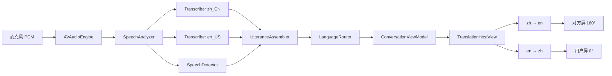

# 02 架构设计

目标：把「麦克风里的一句话」稳定变成「正确一侧屏幕上的一句译文」，并且可测试、可替换、符合 Swift 6 并发模型。

分层图：[`diagrams/system-architecture.svg`](diagrams/system-architecture.svg)
流水线：[`diagrams/data-pipeline.svg`](diagrams/data-pipeline.svg)



---

## 1. 分层

严格单向依赖。UI 不知道 SpeechAnalyzer；Speech 不知道 SwiftUI。

```
┌──────────────────────────────────────────┐
│  App                                     │
│  DuiyiApp · AppEnvironment · 路由        │
├──────────────────────────────────────────┤
│  Features                                │
│  Onboarding · Conversation · Settings    │
├──────────────────────────────────────────┤
│  Domain                                  │
│  会话状态 · 语种路由 · 字幕模型 · 错误    │
├──────────────────────────────────────────┤
│  Services                                │
│  Audio · Speech · Translation · Assets   │
├──────────────────────────────────────────┤
│  DesignSystem                            │
│  Token · Typography · CaptionPane        │
└──────────────────────────────────────────┘
```

| 层 | 可以依赖 | 不可以 |
| --- | --- | --- |
| App | 全部 | — |
| Features | Domain、DesignSystem、通过 Environment 拿的协议 | 直接 `import Speech` / `AVFAudio` |
| Domain | Foundation 级模型 | 任何框架 API、SwiftUI |
| Services | Domain + 系统框架 | SwiftUI View |
| DesignSystem | SwiftUI | 业务状态 |

Translation 框架的 `TranslationSession` **必须锚在 View 上**（`.translationTask`）。这是系统约束，不能假装成纯 Service。做法：Service 层只发 `TranslationJob`，由 `TranslationHostView` 执行，再把结果回灌 ViewModel。这是架构里唯一的「UI 承载系统能力」特例，写进协议，避免散落。

---

## 2. 工程结构

```
Duiyi/
  App/
    DuiyiApp.swift
    AppEnvironment.swift
    AppRoute.swift
  Features/
    Onboarding/
      OnboardingView.swift
      OnboardingViewModel.swift
      LanguagePickView.swift
      PermissionView.swift
      AssetDownloadView.swift
    Conversation/
      ConversationView.swift
      ConversationViewModel.swift
      CaptionPaneView.swift
      ListeningControl.swift
      TranslationHostView.swift
    Settings/
      SettingsSheet.swift
  Domain/
    Models/
      AppLanguage.swift          // zhHans / en
      SpeakerSide.swift          // user / peer
      CaptionLine.swift
      Utterance.swift
      ConversationLayout.swift
    Routing/
      LanguageRouter.swift
    Errors/
      DuiyiError.swift
  Services/
    Audio/
      AudioCapturing.swift
      AudioEngineCapturer.swift
    Speech/
      SpeechRecognizing.swift
      BilingualSpeechEngine.swift
      UtteranceAssembler.swift
    Translation/
      Translating.swift
      TranslationJob.swift
    Assets/
      ModelPreparing.swift
      SpeechAssetPreparer.swift
      TranslationAssetPreparer.swift
    Permissions/
      PermissionGranting.swift
  DesignSystem/
    Tokens.swift
    CaptionTypography.swift
    Components/
  Resources/
    Info.plist
    Localizable.xcstrings
    Assets.xcassets
  DuiyiTests/
    LanguageRouterTests.swift
    UtteranceAssemblerTests.swift
    ConversationViewModelTests.swift
```

命名：类型用能力（`SpeechRecognizing`），实现用技术（`BilingualSpeechEngine`）。测试只绑协议。

---

## 3. 运行时对象图

```
DuiyiApp
  └── AppEnvironment
        ├── PermissionGranting
        ├── ModelPreparing
        ├── AudioCapturing
        ├── SpeechRecognizing
        └── Translating            ← 协议；真正执行在 TranslationHostView

ConversationView
  ├── ConversationViewModel        @MainActor @Observable
  ├── TranslationHostView          锚两个 TranslationSession（zh→en, en→zh）
  ├── CaptionPaneView (peer, 180°)
  ├── ListeningControl
  └── CaptionPaneView (user, 0°)
```

生命周期：

- `AppEnvironment` 用 `@State` 持有，注入 `Environment`。
- 语音引擎是 `actor`，音频回调不进主线程。
- ViewModel 只收已经切好的 `Utterance`（partial / final）。

---

## 4. 核心数据流

```
麦克风
  → AVAudioEngine tap
  → AVAudioConverter（对齐 Analyzer 格式）
  → AsyncStream<AnalyzerInput>
  → SpeechAnalyzer
        ├ SpeechDetector          语音活动
        ├ SpeechTranscriber zh_CN
        └ SpeechTranscriber en_US
  → UtteranceAssembler            融合两路、切句、去重
  → LanguageRouter                决定打到 user / peer
  → ConversationViewModel
        ├ 更新说者侧「正在说…」
        └ 发出 TranslationJob
  → TranslationHostView
        └ TranslationSession.translate
  → CaptionLine 写到目标侧
```

### 4.1 UtteranceAssembler

两路 transcriber 会对同一段音频各吐一段字。必须选出一路，否则中英会抢同一句。

规则（按优先级）：

1. `SpeechDetector` 判定静音超过 700–1100 ms → 结束当前句。
2. 若一路 `isFinal`、另一路仍 volatile → 采 final 路。
3. 两路都有字：用 **脚本密度**（汉字 vs 拉丁字母）加权，而不是只比字符串长度。
4. 短句（< 2 个汉字或 < 2 个英文词）沿用上一句语种，抑制「嗯 / um」误切。
5. 同一句的 volatile 更新用稳定 `utteranceId`，UI 原地改字，不新开一行。

### 4.2 LanguageRouter

纯函数，易于单测。

```swift
func targetSide(
    detected: AppLanguage,
    userLanguage: AppLanguage
) -> SpeakerSide {
    detected == userLanguage ? .peer : .user
}

func targetLanguage(for detected: AppLanguage) -> AppLanguage {
    detected.counterpart
}
```

含义：检测到的语种是用户的语言 → 这是用户在说 → 译文给对方。反之给用户。

### 4.3 字幕模型

```swift
struct CaptionLine: Identifiable, Equatable, Sendable {
    var id: UUID
    var side: SpeakerSide
    var source: AppLanguage
    var sourceText: String
    var translatedText: String
    var phase: Phase          // streaming / settled
    var updatedAt: Date
}

struct PaneState: Equatable, Sendable {
    var live: CaptionLine?    // 当前句
    var previous: CaptionLine?
}
```

每个 Pane 只保留 2 行。新 settled 句把旧 live 降为 previous，再更早的丢弃。内存与界面都有上限。

---

## 5. 会话状态机

```
          prepare
idle ────────────► ready
                    │ start
                    ▼
                 listening ◄── resume
                    │ pause / error
                    ▼
                 paused ──► failed
```

| 状态 | 音频 | 识别 | UI |
| --- | --- | --- | --- |
| `idle` | 关 | 关 | 引导 |
| `preparing` | 关 | 关 | 下载进度 |
| `ready` | 关 | 关 | 「轻点开始」 |
| `listening` | 开 | 开 | 呼吸灯 |
| `paused` | 关 | 关 | 冻结字幕 |
| `failed` | 关 | 关 | 只在用户侧显示错误 |

非法跳转在 ViewModel 内忽略，不向 UI 抛枚举爆炸。

`ConversationViewModel` 对引擎的命令只有：`prepare()` / `start()` / `stop()` / `resetCaptions()` / `setUserLanguage(_:)`。

---

## 6. 并发与线程

遵循 Swift 6 严格并发。

| 组件 | 隔离 | 原因 |
| --- | --- | --- |
| `BilingualSpeechEngine` | `actor` | tap 回调、Analyzer 流、任务取消 |
| `AudioEngineCapturer` | `actor` | `AVAudioEngine` 非线程安全 |
| `ConversationViewModel` | `@MainActor` | 驱动 SwiftUI |
| `LanguageRouter` | 纯值 | 可重入 |
| `TranslationHostView` | MainActor View | 系统要求 session 锚在视图 |

规则：

- 禁止 ViewModel 直接 `installTap`。
- `AsyncStream` 在 `stop()` 时 `finish`，并 `cancel` analyzer 任务，避免泄漏。
- 翻译请求带 `utteranceId`；过期结果丢弃（用户已说下一句）。
- 切换语言对时 `invalidates` 两边 `TranslationSession.Configuration`。

---

## 7. Translation 锚点

系统模型：`TranslationSession` 绑定产生它的 View，View 消失 session 失效。

```
ConversationView
  └── TranslationHostView          // 0×0 不可见，常驻
        .translationTask(zhToEn)
        .translationTask(enToZh)
```

ViewModel 发布：

```swift
var outbound: TranslationJob?     // id + source + text
```

Host 翻译成功后回调 `viewModel.fulfill(job:result:)`。取消码（已知 `TranslationErrorDomain` 14/20）当过期，不弹错。

首次 `prepareTranslation()` 放在引导页的「下载模型」步骤，对话页只做翻译，不再弹下载确认。

---

## 8. 权限与资源

启动顺序固定，避免边听边下模型：

```
麦克风授权
  → 语音识别授权
  → AssetInventory 安装 zh_CN / en_US SpeechTranscriber
  → LanguageAvailability + prepareTranslation（zh↔en 双向）
  → ready
```

`Info.plist`：

- `NSMicrophoneUsageDescription`
- `NSSpeechRecognitionUsageDescription`

不申请跟踪、相册、通讯录。无后台音频模式：离开 App 即停听，省电、也避免「口袋误录」。

---

## 9. 错误模型

统一 `DuiyiError`，用户侧正字展示，倒字侧不显示系统错误（对方看不懂，也无助）。

| 错误 | 用户可见文案 | 恢复 |
| --- | --- | --- |
| 麦克风拒绝 | 请在设置中允许麦克风 | 打开设置 |
| 语音识别拒绝 | 请在设置中允许语音识别 | 打开设置 |
| 模型未下载 | 需要先下载中英模型 | 重试下载 |
| 语种不受支持 | 这台设备暂时不能离线识别该语言 | 说明设备门槛 |
| 识别中断 | 识别暂停了，轻点继续 | start() |
| 翻译暂不可用 | 听清了，但译文还没好 | 保留原文短时，重试翻译 |

不把 `localizedDescription` 原样丢上字幕板。

---

## 10. 测试策略

| 层级 | 测什么 | 怎么测 |
| --- | --- | --- |
| Domain | 路由、切句、去重 | 纯单元测试，无设备 |
| ViewModel | 状态机、过期翻译丢弃、清屏 | mock `SpeechRecognizing` |
| Engine | 格式转换、启停幂等 | 用夹具 wav（CI 可选，真机必测） |
| UI | 倒字、字号三档、设置长按 | Snapshot + 真机桌面场景 |

Preview：每个 Feature View 带 `listening` / `streaming` / `failed` 三态。

---

## 11. 与旧工程的关系

`realtimeTranslator/` 已验证：

- iOS 26 `SpeechAnalyzer` 实时路径
- `TranslationSession` + `translationTask` 往返
- 静音切句与中英脚本探测

**不复用其 UI**（那是单人字幕流 + 调试台）。新工程在 `realtimeTranslator-ox` 重写。可移植的是：音频 tap → Analyzer 的转换、翻译取消码处理、权限申请顺序。移植时改成 `actor` + 协议，去掉 callback 拼盘。

---

## 12. 编码实践（本项目强制）

- Swift 6、严格并发、禁止 `!` 解包 UI 状态。
- View 不写业务：`ConversationView` 只绑 `ViewModel` 与组件。
- 新 API 用 `#available` 包裹的遗留路径不进 v1（部署目标就是 iOS 26）。
- 所有字幕字符串经 `LocalizedStringResource` / `xcstrings`。
- PR 必备：路由测试 + 主界面 Preview。
