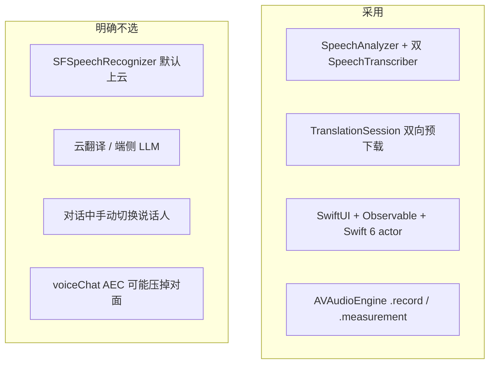

# 03 技术选型

部署目标：**iOS 26.0+**，真机优先（模拟器对 SpeechAnalyzer / 离线翻译模型支持不完整）。
设备门槛：能跑 iOS 26 的 iPhone；Neural Engine 参与系统语音与翻译模型。



---

## 1. 决策总表

| 问题 | 选择 | 不选 | 原因 |
| --- | --- | --- | --- |
| UI | SwiftUI | UIKit 主界面 | 倒字、分屏、状态驱动字幕是声明式强项；系统 Translation 也绑在 View |
| 状态 | `@Observable` + `@MainActor` | `ObservableObject` | iOS 26 默认；更新粒度更细，少一层 `objectWillChange` |
| 并发 | Swift 6 / `actor` | 自由 GCD + delegate | 音频与识别必须离开主线程，且要可取消 |
| 语音 | `SpeechAnalyzer` + 双 `SpeechTranscriber` | 仅 `SFSpeechRecognizer` | 设备端、长句、远场；旧 API 默认可走服务器，不满足「离线实时」 |
| 切句 | `SpeechDetector` + 静音窗口 | 只靠 `isFinal` | 对话里 final 来得晚，桌面场景需要可预期的句边界 |
| 语种 | 双 locale 并行 + 脚本融合 | 运行中热切换单个 recognizer | 热切换会丢当前句；双路才适合中英插话 |
| 翻译 | `Translation.framework` | 云 API / 端侧 LLM | 系统级离线模型、隐私、无密钥、与系统翻译包共享 |
| 音频 | `AVAudioEngine` tap | `SFSpeechAudioBufferRecognitionRequest` 单用 | Analyzer 吃 `AnalyzerInput`，必须自己送 buffer |
| 存储 | 不存对话 | Core Data / 云 | v1 是当面工具，不留语音、不留文本 |
| 最低系统 | iOS 26 | iOS 18 + 旧 Speech | 产品承诺就是新一代离线实时能力 |

---

## 2. 语音：为什么是 SpeechAnalyzer

WWDC25 起，系统把 Notes 等实时转写换到新模型。对对译的意义：

- **离线**：音频不出设备（旧 `SFSpeechRecognizer` 默认可上传）。
- **远场 / 长时**：按会议、讲座场景训练，适合桌面距离，而不是对着话筒短指令。
- **模块化**：同一 `SpeechAnalyzer` 可挂多个 module。
- **资源可预下载**：`AssetInventory.assetInstallationRequest(supporting:)`，引导期一次装好。

模块组合：

| Module | 角色 |
| --- | --- |
| `SpeechTranscriber(locale: zh_CN)` | 中文转写，`reportingOptions: [.volatileResults]` |
| `SpeechTranscriber(locale: en_US)` | 英文转写，同样要 volatile |
| `SpeechDetector` | 语音活动，辅助切句 |

`SpeechTranscriber` 当前支持 `zh_CN` / `zh_HK` / `zh_TW` / `yue_CN` 与多地区英语。v1 锁定 **简体中文 `zh_CN` + 美式英语 `en_US`**。港澳繁体不进 v1，避免模型组合爆炸。

`DictationTranscriber` 带标点格式，但更偏听写；对话字幕用 `SpeechTranscriber` + 系统标点选项即可。

### 双路并行的代价

系统对同时分析有保守上限，超了会 `insufficientResources`。对策：

1. 先按默认 limits 跑双 Transcriber + Detector。
2. 若失败，降级为「单路 + 脚本探测后重启另一路」（会丢约一句，作为兼容路径）。
3. 不轻易打开 `SpeechAnalyzer.Options.ignoresResourceLimits`；打开后失败不可预测。

旧工程 `realtimeTranslator` 已在真机跑通 **单路** Analyzer。双路是本项目最大技术风险，必须在 M2 真机验证，见路线图。

---

## 3. 翻译：为什么是 TranslationSession

`Translation` 从 iOS 18 起提供应用内翻译：

- 模型与系统「翻译」App 共享，用户下过一次，本 App 不用再下。
- `prepareTranslation()` 可在未开译前要下载授权，适合引导页。
- `LanguageAvailability.status(from:to:)` 可区分 `installed` / `supported` / `unsupported`。

约束（必须遵守）：

1. Session 锚在 View。不能在 `actor` 里 `init` 一个长期活着的 session 当全局单例。
2. 源/目标要用 `LanguageAvailability.supportedLanguages` 里的值，不要手写奇怪 identifier。
3. 双向各一个 configuration：`zh-Hans → en` 与 `en → zh-Hans`。不要每次识别完再新建语言对，否则会反复 invalidate、闪下载界面。
4. 中间结果也可以送译，但要节流；整句 final 再打一次，用 final 覆盖。

不选云翻译：需要网络、密钥、隐私协议、延迟不稳定，和「咖啡馆离线对话」冲突。

不选端侧 LLM：包体、发热、中英质量与系统翻译包相比没有产品优势。

---

## 4. 语种识别：为什么不单独上 LID 模型

可选方案：

| 方案 | 延迟 | 复杂度 | v1 |
| --- | --- | --- | --- |
| 双 Transcriber 融合 | 低（已经在算） | 中 | **采用** |
| `NLLanguageRecognizer` 看文本 | 低 | 低 | 仅作融合的第三票 |
| 端侧 LID（ECAPA 等） | ~15 ms | 高，自带模型 | 不做 |
| 用户按住「我在说」 | 0 | 交互变复杂 | 否决 |

融合伪代码：

```
score(zh) = hanRatio * 2 + zhTranscriberConfidence
score(en) = latinRatio + enTranscriberConfidence
pick max; if both low → keep lastLanguage
```

`NLLanguageRecognizer` 对超短句（「好」「OK」）不可靠，只当弱特征。

---

## 5. 音频会话

```
category: .record
mode:     .measurement      // 少处理，把干净 PCM 给模型
options:  .duckOthers, .allowBluetoothHFP
```

不选 `.voiceChat`（会做 AEC，桌面上两人离麦克风距离接近时，可能把对方当回声压掉）。
不选 `.spokenAudio`。
不用 `.playAndRecord`：v1 不播放 TTS。

停听时 `setActive(false, .notifyOthersOnDeactivation)`。
对话中 `UIApplication.shared.isIdleTimerDisabled = true`。

蓝牙耳机：允许，但不作为推荐场景（平放桌子才是产品）。插入耳机时对方更难被拾取，设置里用一句话提示「请把手机平放在两人中间」。

---

## 6. 界面与系统能力

| 能力 | 用法 |
| --- | --- |
| SwiftUI `rotationEffect(180)` | 对方整块容器旋转，文字与排版仍按正常写 |
| `.translationTask(configuration:)` | 两个 Host，或同一 View 两个 modifier |
| `UISupportedInterfaceOrientations = Portrait` | 正面朝上时禁止自动旋转把两侧对调 |
| `idleTimerDisabled` | 防止对话中途熄屏 |
| `xcstrings` | 界面语言跟随「我看的语言」 |

倒字不用 `scaleEffect(x: -1)` 或逐字镜像：那会把字形画反。只要整块 UI 转 180°。

---

## 7. 最低能力检测

启动时顺序检查，失败给明确失败态：

1. `SpeechTranscriber.isAvailable`（硬件相关，光看系统版本不够）
2. `supportedLocale(equivalentTo: zh_CN / en_US)`
3. `LanguageAvailability.status` 对 `zh-Hans ↔ en`
4. 麦克风 + 语音识别授权

任一 `unsupported` → 引导页说明「这台设备还不能离线中英对译」，不要进主界面空转。

---

## 8. 性能与发热预算

桌面连续对话按 **30–45 分钟** 设计。

| 项目 | 预算 |
| --- | --- |
| 识别 volatile 刷新 | 不限制，UI 只改字符串 |
| 送去翻译 | ≤ 3 次/秒，按 `utteranceId` 合并 |
| 历史字幕 | 每侧 2 行 |
| 音频 tap buffer | 1024 frames，转完即弃 |
| 日志 | `#if DEBUG`，Release 无控制台字幕 |

超预算时的降级顺序：停 Detector 以外的调试 → 停 volatile 翻译（只译 final）→ 停双路改单路。产品仍可用，只是实时感变差。

---

## 9. 隐私

- 语音与文本默认不写磁盘、不上云、不进分析 SDK。
- 系统仍可能在用户已装的翻译/语音框架内管理模型文件，这是 OS 行为，App 不另存副本。
- 权限文案直说「只在本机转写和翻译，用于当面字幕」。

---

## 10. 旧代码可借鉴点

从 `realtimeTranslator` 带走的，仅限实现细节：

- `BufferConverter`：把硬件 tap 格式转到 `SpeechAnalyzer.bestAvailableAudioFormat`
- `prepareTranslation` 与 invalidate configuration 的时机
- 翻译取消错误码 14 / 20 当过期

不带走：`ObservableObject` callback 识别器、调试面板、单 locale 热切换、把原文译文叠在同一张卡上的 UI。
