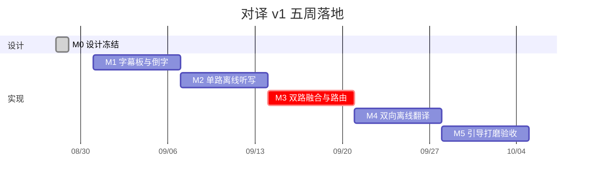

# 04 项目落地线路图

原则：**先在真机上证明双路离线听写 + 双向离线翻译，再打磨桌面字幕板。** 界面可以平行做，但 M2 过不去就不要承诺「实时对译」。



周期按 1 名熟悉 SwiftUI 的 iOS 工程师估算。日历约 **5 周**到可当面试用的 v1。

---

## 总览

```
W1 骨架与字幕板
W2 单路离线听写（真机）
W3 双路融合 + 路由
W4 离线翻译接入
W5 引导、降级、打磨、验收
```

| 里程碑 | 产出 | 过关标准 |
| --- | --- | --- |
| M0 设计冻结 | 本目录文档 + 原型 | 产品规则、技术栈无未决项 |
| M1 可看 | 分屏倒字 App 壳 | 平放桌子，两侧字方向正确 |
| M2 可听 | 单路 SpeechAnalyzer | 离线说出中文或英文，主屏出字 |
| M3 可分 | 双路 + LanguageRouter | 中英交替说话，字幕打到正确一侧 |
| M4 可译 | TranslationSession 双向 | 断网后仍能出译文 |
| M5 可用 | 引导 + 错误 + 字号 | 新人 30 秒开用，当面 10 分钟对话不崩 |

---

## 第 0 周 · 设计冻结（当前）

- [x] 场景与字幕路由规则
- [x] 界面原型
- [x] 架构与技术选型
- [x] 干系人过一遍原型 HTML，确认「自动聆听 / 语言默认跟系统」无异议后再建工程

出口：本目录文档不再改产品规则。之后只改实现。

---

## 第 1 周 · M1 骨架与字幕板

**目标：** 没有麦克风也能演示「平放、倒字、两行字幕、一个按钮」。

任务：

1. 在 `realtimeTranslator-ox` 建 Xcode 工程 `Duiyi`，Bundle ID、竖屏锁定、隐私文案占位。
2. DesignSystem：色板、三档字号、`CaptionPaneView`、`ListeningControl`。
3. `ConversationView` 用假数据跑通：空闲 / 聆听 / 用户在说 / 对方在说。
4. 设置卡片：语言对调、字号、清屏。
5. `idleTimerDisabled`、禁止自动旋转。

验收：

- 真机平放，对面的人认为上半屏是正字。
- 动态字体与「最大」档不把按钮顶出安全区。
- Preview 覆盖四态。

风险：无。

---

## 第 2 周 · M2 单路离线听写

**目标：** 证明 iOS 26 设备端实时转写在桌面距离可用。

任务：

1. `PermissionGranting`：麦克风 + 语音识别。
2. `AudioEngineCapturer` + 格式转换（可从旧工程移植 Converter）。
3. 单 `SpeechTranscriber`，locale 跟「我看的语言」的**对侧**先跑通（先听对方），再切到用户语言。
4. `AssetInventory` 下载进度接到引导页雏形。
5. DEBUG 日志用 `os.Logger`，不进主界面。

验收：

- 飞行模式，对着桌子说话，1 秒内出 volatile 字。
- 停 1 秒左右切句。
- 杀进程再进，模型无需重下。

风险：模拟器没有模型。**全部验收在真机。** 旧工程已验证单路，本周风险低。

---

## 第 3 周 · M3 双路融合与路由

**目标：** 中英插话时，字幕出现在该看的那一侧。

任务：

1. 同一 `SpeechAnalyzer` 挂 `zh_CN` + `en_US` + `SpeechDetector`。
2. `UtteranceAssembler`：脚本密度、final 优先、短句沿用上句语种。
3. `LanguageRouter` 单测：四种说话组合全覆盖。
4. 资源不足时的单路降级开关。
5. ViewModel 状态机接到真实引擎。

验收（两人、飞行模式）：

| 动作 | 期望 |
| --- | --- |
| 用户说中文 | 上半屏出英文转写（此时还没有翻译，先出原文或「译字准备中」占位） |
| 对方说英文 | 下半屏出英文转写占位 |
| 快速交替 | 不串句、不在两侧各写一遍 |

说明：本周可以还没有翻译，但**路由必须对**。转写语言应等于 detected，打到的 side 应符合规则。

风险：**高**。双 Transcriber 可能 `insufficientResources`。缓冲：降级单路 + 句末切换 locale（会丢半句，仅作为兼容）。

---

## 第 4 周 · M4 离线翻译

**目标：** 听者侧看到的是译文，不是原文。

任务：

1. `TranslationHostView` 常驻两个 `TranslationSession.Configuration`。
2. 引导页 `prepareTranslation()` 预下载 zh↔en。
3. volatile 250–400 ms 节流翻译；final 再译一次并 `settled`。
4. 过期 `utteranceId` 丢弃；取消码 14/20 不弹窗。
5. `LanguageAvailability` 未安装 / 不支持 的失败态。

验收：

- 打开飞行模式后完整对话：中文→上屏英文，英文→下屏中文（用户看中文时）。
- 对调「我看英文」后路由与翻译方向一起对调。
- 第一次安装弹出系统下载确认；第二次不再弹。

风险：中。Session 与 View 生命周期绑死，设置 sheet 不可拆掉 Host。翻译中间句可能拙——用 final 覆盖即可。

---

## 第 5 周 · M5 引导、稳定性、打磨

**目标：** 交给没做过 iOS 的人，能当面用十分钟。

任务：

1. 欢迎 / 选语言 / 权限 / 下载 四步，可断点续。
2. 再次启动：已就绪则自动聆听（可关）。
3. 错误只出现在用户侧正字。
4. 暂停 30 秒后恢复自动锁屏。
5. 误触：字幕区点击无效果；长按才出设置。
6. 无障碍：倒字侧 `accessibilityHidden`。
7. 内存：连续说 20 分钟，每侧仍只有 2 行。
8. 发热：连续 20 分钟可接受（不烫到放不在桌上）。
9. 单元测试：Router、Assembler、ViewModel 过期翻译。
10. 去掉任何 Debug 可视化。

验收清单见文末。

---

## 依赖与并行

```
M0 文档
  └─ M1 UI 壳 ─────────────────────┐
       └─ M2 单路听写              │
            └─ M3 双路+路由        ├─ M5 打磨
                 └─ M4 翻译 ───────┘
```

M1 与 M2 可两人并行。一人时必须 M2 不晚于 W2，因为 M3 才是未知数。

外部依赖：

- Xcode 带 iOS 26 SDK
- 至少一台 iOS 26 真机（建议 iPhone 15 及以上）
- 首次需网络下模型；验收「离线」在下载完成之后

---

## 明确不做（v1 冻结）

- 说话人分离 / 双麦克风波束对准某一个人
- 面对面模式里 TTS 把译文读出来（朗读只出现在同声传译模块，且必须戴耳机）
- 会话记录、导出、账号
- 粤语、繁体（第三语言已在后续迭代进入六语对）
- 横屏、iPad 分栏、CarPlay
- 后台持续听
- 云翻译降级（断网就必须仍能译；模型没下好则引导去下，不上云顶）

v1.1 / 同声传译模块（单独排期，不打进原五周面对面）：见 [`05-simultaneous-prototype.md`](05-simultaneous-prototype.md) 起。

---

## M5 当面验收脚本

环境：飞行模式、两人对坐、手机平放、系统已装中英翻译包。

1. 卸载重装。走完引导，计时应 < 90 秒（不含模型下载等待）。
2. 用户选「我看中文」。对方说一句英文。用户下半屏出现中文，上半屏不出现大号中文。
3. 用户说一句中文。对方（倒头看上半屏）看到英文正字。
4. 对调「我看英文」，重复 2–3，方向相反。
5. 暂停，字幕冻结；再开始，继续听。
6. 拒绝权限的冷启动：用户侧有「去设置」，对方侧保持干净。
7. 连续交替 10 分钟：无崩溃、无双份字幕、无自动旋转导致双方对着倒字。

全部通过 → v1 可进入 TestFlight。

---

## 工程启动命令（M1 第一天）

用 Xcode 建 iOS App：

- Product Name: `Duiyi`
- Interface: SwiftUI
- Language: Swift
- Minimum: iOS 26.0
- 目录：`realtimeTranslator-ox/Duiyi`

`Info.plist` 预置：

- `NSMicrophoneUsageDescription`：需要麦克风，才能在本机把对话转成字幕。
- `NSSpeechRecognitionUsageDescription`：需要语音识别，才能在本机把中文和英文转成文字。不上传语音。
- `UISupportedInterfaceOrientations`：仅 Portrait
- 显示名：对译

本线路图完成前 **不写业务代码**。下一动作：过原型 → 按 M1 建工程。

实现进度（2026-08-28）：`Duiyi.xcodeproj` 已按 M1–M5 一次落地（分屏倒字 UI、双路 SpeechAnalyzer、路由、TranslationSession、引导、单测）。待真机验证双路资源与离线翻译下载。
