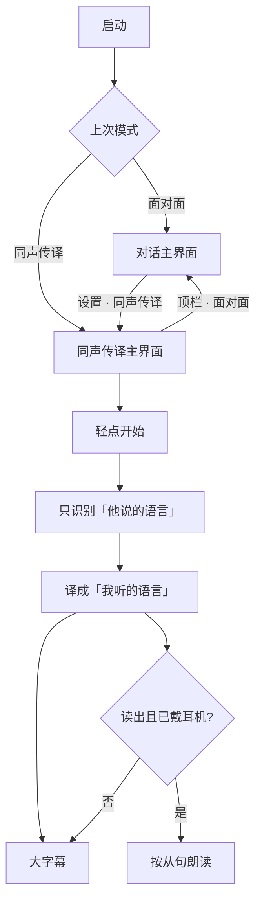

# 05 同声传译 · 产品原型

模块名：**同声传译**
宿主 App：**对译 Duiyi**
形态：与「面对面」并列的第二种用法，不是替换桌面字幕板

可交互界面：[`../prototype/simultaneous.html`](../prototype/simultaneous.html)
架构：[`06-simultaneous-architecture.md`](06-simultaneous-architecture.md)

面对面：两人隔桌，手机平放，字幕打到各自朝向的一侧。
同声传译：**一个人听现场**（讲座、会议、导游、电视），手机朝向自己，实时读到（可选听到）译文。

---

## 1. 使用场景

用户坐在听众席或站在展厅。说话人用一种语言讲，用户需要几乎同时看懂。

```
        说话人（日语 / 英语 / …）
                    │
                    ▼  空气声
        ┌─────────────────────┐
        │  同声传译 · 正字     │  ← 只给用户看
        │                     │
        │   译文（大）          │
        │   原文（小，可关）    │
        │                     │
        │      ● 聆听中        │
        │   耳机可选读出译文    │
        └─────────────────────┘
                    ▲
                    │
              用户（听中文）
```

和面对面的差别：

| | 面对面 | 同声传译 |
| --- | --- | --- |
| 谁看屏幕 | 两个人，对坐 | **只有用户** |
| 屏幕 | 上下对半，上半屏转 180° | **单栏正字** |
| 方向 | 双向，靠识别语种路由 | **单向**：他说 → 我听 |
| 输出 | 只出字幕 | 字幕 + 可选语音 |
| 手机怎么放 | 必须平放桌面 | 握在手里、支在桌上、或只戴耳机 |
| 主路径按钮 | 开始 / 暂停 | 同样只有开始 / 暂停 |

不把同声传译做成「再选一次当前说话人」的会议系统。用户进模块时选定方向，之后只点中间那个钮。

---

## 2. 产品规则

1. **他说的语言** + **我听的语言**，必须不同。选到同一边则对调。
2. 识别只跑「他说的」那一路。不在同声传译里并行六路听写。
3. 屏幕只给用户看：**当前译文最大**，上一句降低对比，更早的进可滚动历史。
4. 原文默认一行小字，设置里可关。说话人已经听见自己的话，用户偶尔对一下原文即可。
5. **读出译文默认关闭。** 打开时：
   - 已接耳机 / 听筒 → 朗读译文，麦克风继续听（系统回声消除）。
   - 外放 → 不允许朗读，提示「戴上耳机再读出，避免自己的喇叭被再次识别」。
6. 中途可点徽章换语言、点对调箭头换方向。换方向后当前句丢弃，历史保留（用户可能还要回头看）。
7. 离开 App 或锁屏：停止听和读。不做后台同传。

默认语言：我听 = 系统语言；他说 = 我听的 `defaultPeer`（系统是中文则默认听对方英语）。

---

## 3. 信息架构

```
启动
  ├─ 首次：现有引导（语言、权限、模型）
  └─ 再次：进入「上次用的模式」

选模式（设置里随时可换，主界面一键返回）
  ├─ 面对面 → ConversationView（已有）
  └─ 同声传译 → InterpretationView（本模块）

同声传译主界面
  ├─ 顶栏：模式名 + 回面对面
  ├─ 方向条：他说 · 对调 · 我听
  ├─ 字幕柱：live 译文 + 历史 + 一行原文
  ├─ 中央：开始 / 暂停（长按设置）
  └─ 读出开关（无耳机时禁用）
```



---

## 4. 关键界面

### 4.1 模式入口

设置卡片最上方两个等宽选择：

- **面对面** — 把手机平放在两人中间
- **同声传译** — 听现场，看（或听）译文

选中态用现有金色 `accent.listen`，不要再做第三套皮肤。

首次完成引导后仍进面对面（桌面场景是品牌记忆）。用户在设置里切到同声传译后记住选择。

### 4.2 同声传译主界面

竖屏一块板。没有倒字。

```
┌─────────────────────────────┐
│  同声传译              面对面 │
│                             │
│  JA 他说     ⇅     我听 ZH  │
│                             │
│  我想点一杯咖啡。            │  ← 当前译文 28–34 pt
│                             │
│  三点在酒店大堂见。          │  ← 历史，可滚
│                             │
│  原文  コーヒーをください     │  ← 13 pt，可关
│                             │
│           ( ● )             │
│          聆听中              │
│      读出译文 · 请戴耳机     │
└─────────────────────────────┘
```

状态：

| 状态 | 中央 | 字幕柱 |
| --- | --- | --- |
| 空闲 | 空心麦，「轻点开始」 | 「开始听现场说话。」 |
| 准备 | 省略号，「正在准备…」 | 低对比 |
| 聆听 | 呼吸灯 + 波形 | 等下一句；有字则滚动 |
| 暂停 | 实心麦 | 冻结 |
| 失败 | 警告 | 正字说明，可去设置 / 重试 |

顶栏「面对面」是文字按钮，不是汉堡菜单。用户要能一眼找到回头的路。

### 4.3 方向条

- 左侧徽章：他说的语言，点开与面对面相同的六语芯片
- 中间 `arrow.up.arrow.down`：对调方向
- 右侧徽章：我听的语言

两边文案跟随「我听的语言」。不要让只懂中文的用户去点 English 设置项。

### 4.4 读出译文

主界面底部一行，不进二级页：

- 关：`读出译文`
- 开且有耳机：`正在读出`
- 开但被拒绝：`请戴上耳机再读出`

不在同声传译 v1 做「边说边外放给全场听」。那是扩音器，会啸叫。

### 4.5 设置卡片

长按中央按钮，贴底出现，不盖住当前译文的上半。

- 切模式：面对面 / 同声传译
- 他说 / 我听（与方向条同一套芯片）
- 显示原文：开 / 关
- 字号：标准 / 更大 / 最大（复用 CaptionFontSize）
- 读出译文
- 清屏、总结这次（复用已有摘要能力）
- 重新下载这一对模型

---

## 5. 交互细则

### 只要一个主按钮

- 点按：开始 / 暂停。
- 长按：设置。
- 字幕区不响应普通点按。徽章和对调是明确的小热区。

进同声传译后 **不自动开始**（现场可能已经在讲话，突然听会吓一跳，也更容易误录旁边的人）。空闲态一句引导：「轻点开始，听现场。」

### 实时感（耳口差）

同传允许译文比原话晚半句到一句。不要为了「每个音节都读出来」打断听写。

1. 字幕：volatile 仍尽快上屏（与面对面同一套节流翻译）。
2. 朗读：只读 **已经切出的从句**（标点或短暂停顿），不读正在变长的半截词。
3. 新从句到来时，若上一句还在读：排进队列，最多积压 **2 句**；再多则丢掉最旧的，跟上说话人。
4. 用户暂停：立刻 `stopSpeaking`，清空队列。

### 换方向 / 换语言

- 对调或改语种：停听 → 如需要则下载这一对模型 → 清当前 live → 不自动恢复听，回到「轻点开始」（现场环境可能已经变了）。
- 历史字幕保留，新方向的句子接在后面。总结时带上全部。

### 熄屏与误触

- 聆听中 `isIdleTimerDisabled = true`。
- 暂停 30 秒后恢复自动锁（与面对面相同）。
- 热区：中央 64 / 88 pt，方向条徽章，读出开关。其余是字幕板。

---

## 6. 视觉规范

沿用 [`01-product-prototype.md`](01-product-prototype.md) 色板，不另起霓虹主题。

同声传译只加两个可辨识差异，让用户知道「现在不是对坐模式」：

| Token | 用途 |
| --- | --- |
| `bg.user` `#161920` | 整屏底（不再对半暖冷） |
| 顶栏一条 1 pt `sheetChip` 分割 | 和面对面的中缝区分：这里的中缝在底部控制带 |
| 方向条中间的对调箭头 | 唯一新增图形 |

字号：当前译文跟面对面 live（默认更大档，封顶 32 pt）。原文固定 13 pt Regular，颜色 `text.secondary`。

动效：新句淡入 + 4 pt，180 ms；volatile 只改字；降低动态跟系统。

---

## 7. 无障碍

- 整屏都给用户，全部进入 VoiceOver。面对面倒字侧继续隐藏。
- 方向条：`他说，日语` / `对调双方语言` / `我听，中文`。
- 读出开关：说明「需要耳机」。
- 动态字体与三档产品字号同时生效，译文封顶仍 32 pt，避免一屏只剩两行还溢出去。

---

## 8. 成功标准（原型验收）

不看说明书，应能在 20 秒内完成：

1. 从面对面的设置里进入同声传译
2. 确认「他说 / 我听」
3. 轻点开始，现场说话后看到译文
4. 戴上耳机后打开读出，能听到上一句译文，字幕仍在往前走
5. 一键回到面对面

任何需要「先点我在说 / 他在说」才能听的步骤，视为原型失败。

---

## 9. 明确不做（本模块 v1）

- 外放朗读、会议扩音
- 多说话人分离、声纹
- 同屏倒字（那是面对面）
- 云端同传、WebSocket 流式 TTS
- 后台锁屏持续听
- 自动语言检测（现场噪音里不稳；方向由用户定）
- 把面对面和同声传译揉在同一个 ViewModel 里用 if 切换布局
