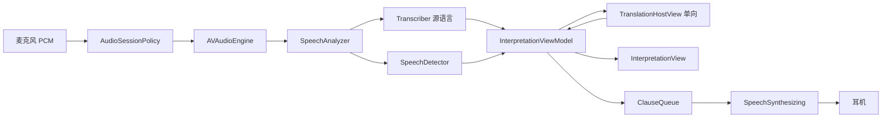

# 06 同声传译 · 架构设计

目标：在现有 Duiyi 分层上增加 **Interpretation** 功能模块，把「现场的一句话」变成「用户屏上的译文」，可选再变成「耳机里的一句朗读」。可测试、可替换、遵守 Swift 6。

分层图：[`diagrams/si-system.svg`](diagrams/si-system.svg)
流水线：[`diagrams/si-pipeline.svg`](diagrams/si-pipeline.svg)
产品规则：[`05-simultaneous-prototype.md`](05-simultaneous-prototype.md)



---

## 1. 模块边界

同声传译是 **Feature**，不是新 App。

| 复用 | 新建 | 禁止 |
| --- | --- | --- |
| `AppLanguage`、`Copy.pick`、Tokens | `Features/Interpretation/` | 在 `ConversationViewModel` 里堆 `if mode == .si` |
| `SpeechRecognizing.start(languages:fallback:)` 只传源语言 | `InterpretationViewModel` | Feature 层 `import Speech` / `AVFAudio` |
| `TranslationHostView`（单向 configuration） | `ClauseQueue`、`SpeechSynthesizing` | 朗读走云 API |
| 权限、模型准备、摘要 | `AudioSessionPolicy` | 面对面引擎与同传抢同一个未停止的 Analyzer |
| 设置卡片视觉 | `AppMode` 偏好 | 两个模式同时 `start()` |

同一时刻只允许一个语音引擎会话。`RootView` 按 `AppMode` 只挂一个主界面。切模式时先 `stop()` 再切换。

---

## 2. 分层（相对现有工程的增量）

```
App
  AppMode                 // faceToFace / simultaneous
  RootView 按模式选主界面
Features
  Conversation/           // 已有，不动核心规则
  Interpretation/         // 新增
    InterpretationView
    InterpretationViewModel
    DirectionBar
    VoiceOutControl
    InterpretationSettingsSheet
Domain
  AppMode
  InterpretationLayout
  Clause          // 可供朗读的从句
  SynthesisJob
Services
  Speech/         // 已有引擎，同传只 start 一个 locale
  Translation/    // 已有，Host 只锚一对方向
  SpeechSynthesis/  新增 SpeechSynthesizing actor
  Audio/          新增 AudioSessionPolicy
```

依赖规则与 [`02-architecture.md`](02-architecture.md) 相同。Translation 仍必须锚在 View 上：`InterpretationView` 放一个 **单向** `TranslationHostView`。

朗读是纯 Service：`AVSpeechSynthesizer` 不绑 View，可放在 `actor`。这是与 Translation 的关键差别。

---

## 3. 工程结构（新增文件）

```
Duiyi/
  App/
    RootView.swift                 // 按 AppMode 分支
  Domain/
    Models/
      AppMode.swift
      Clause.swift
      SynthesisJob.swift
  Features/
    Interpretation/
      InterpretationView.swift
      InterpretationViewModel.swift
      DirectionBar.swift
      VoiceOutControl.swift
      InterpretationSettingsSheet.swift
  Services/
    Audio/
      AudioSessionPolicy.swift     // actor
    SpeechSynthesis/
      SpeechSynthesizing.swift     // protocol
      SystemSpeechSynthesizer.swift
    Speech/
      ClauseSplitter.swift         // 纯函数，可放 Domain
DuiyiTests/
  ClauseSplitterTests.swift
  InterpretationViewModelTests.swift
  AudioSessionPolicyTests.swift    // 耳机判定用假 Route
```

`BilingualSpeechEngine.start(languages:fallback:)` 已支持 1 或 2 个语言。同传传入 `[sourceLanguage]`，走单路 pipeline，资源更省，也避免第二路抢字。

---

## 4. 运行时对象图

```
DuiyiApp
  └── AppEnvironment          // 增加 synthesizer、audioSession
        ├── SpeechRecognizing
        ├── SpeechSynthesizing
        ├── AudioSessionPolicy
        └── …

RootView
  ├── ConversationView            AppMode.faceToFace
  └── InterpretationView          AppMode.simultaneous
        ├── InterpretationViewModel    @MainActor @Observable
        ├── TranslationHostView        仅 source → target
        ├── DirectionBar
        ├── Caption 柱（单栏）
        ├── ListeningControl           复用，swap 绑对调方向
        └── VoiceOutControl
```

`PreferencesStore` 增：

```swift
var appMode: AppMode
var sourceLanguage: AppLanguage   // 他说
var targetLanguage: AppLanguage   // 我听
var voiceOutEnabled: Bool
var showsSourceLine: Bool
```

与面对面的 `userLanguage` / `peerLanguage` **分开存**。切模式不互相覆盖。

---

## 5. 核心数据流

```
开始
  → AudioSessionPolicy.activate(for: .interpretation(voiceOut:))
  → SpeechRecognizing.start(languages: [source], fallback: source)
  → Utterance（单路，Assembler 仍可用，只是另一路为空）
  → InterpretationViewModel.accept
        ├ 更新 live 原文
        └ TranslationJob(source → target)
  → TranslationHostView.translate
  → fulfill
        ├ 写 live / history 译文
        └ 若 voiceOut：ClauseSplitter.consume → SynthesisJob
  → SpeechSynthesizing.enqueue
  → AVSpeechSynthesizer
```

### 5.1 为什么同传仍用 UtteranceAssembler

单路时 Assembler 几乎透传。保留它是为了：

- 同一套 `isFinal` / 续写合并 / 静音切句
- 以后若要「自动在源语言和用户语言之间侦测插话」可以再挂第二路，而不改 ViewModel

同传 v1 不启用第二路。

### 5.2 ClauseSplitter

纯函数，输入 settled 或带句读的译文，输出零或多条 `Clause`。

```swift
struct Clause: Equatable, Sendable, Identifiable {
    var id: UUID
    var utteranceID: UUID
    var text: String
    var language: AppLanguage
}
```

切分优先级：

1. 文本以 `，。！？；;:!?` 结束 → 整段可朗读
2. 静音切句（与 `silenceCommitMilliseconds` 对齐）→ 无论有无标点都可朗读
3. volatile 且无标点 → **不朗读**，只更新字幕

同一 `utteranceID` 变长时：只朗读 **新增后缀**，避免「我想」「我想点」「我想点一杯」读三遍。

### 5.3 朗读队列

`InterpretationViewModel` 内：

- `pendingClauses: [Clause]` 上限 2
- 超出：丢掉最旧，跟上说话人（同传的耳口差策略）
- `SpeechSynthesizing` 一次只说一句，结束回调再取下一条
- `stop()` / 暂停：`synthesizer.stopAndClear()`

过期规则：用户已清屏或已换方向的 `utteranceID` 丢弃。

---

## 6. 会话状态机

与面对面共用 `SessionState` 枚举（idle / preparing / ready / listening / paused / failed），避免两套状态。

差异只在 ViewModel 的策略：

| | 面对面 | 同声传译 |
| --- | --- | --- |
| 进入主界面 | 可自动聆听 | **不自动聆听** |
| `start` 的 locales | `[user, peer]` | `[source]` |
| 翻译方向 | 双向 Host | 单向 Host |
| 换语言后 | 可恢复聆听 | 回到 ready，等用户再点 |

非法跳转仍在各自 ViewModel 内忽略。

ViewModel 对外命令：

```swift
func bootstrap() async
func toggleListening() async
func setSourceLanguage(_:)
func setTargetLanguage(_:)
func swapDirection()
func setVoiceOutEnabled(_:)
func resetCaptions()
```

---

## 7. 音频会话策略

`AudioSessionPolicy` 是 `actor`，唯一调用 `AVAudioSession.setCategory`。

| 模式 | category | mode | 选项 |
| --- | --- | --- | --- |
| 面对面 | `.record` | `.measurement` | `duckOthers`, `allowBluetoothHFP` |
| 同传 · 只字幕 | `.record` | `.measurement` | 同上 |
| 同传 · 读出 | `.playAndRecord` | `.voiceChat` | `allowBluetoothA2DP` / HFP、`defaultToSpeaker = false` |

判定「可以读出」：

```swift
func canSpeakWithoutEcho() -> Bool
```

真：`currentRoute` 含 headphones、bluetoothA2DP、bluetoothLE、bluetoothHFP，或 `builtInReceiver`。
假：只有 `builtInSpeaker`。ViewModel 把开关打回关，并给出文案。

插拔耳机用 `AVAudioSession.routeChangeNotification`，在 actor 里转发到 MainActor 回调。拔掉耳机立即 `stopAndClear`。

切回面对面之前：停合成、停识别、`activate(for: .faceToFace)`。

---

## 8. Translation 锚点

```
InterpretationView
  └── TranslationHostView(
        source: sourceLanguage,
        target: targetLanguage,
        job: outboundJob,
        …
      )
      .id("\(source)-\(target)")
```

只需要 **一条** `translationTask`。不要为同传再挂反向 session（对调方向时改 id，系统重建 configuration）。

`prepareTranslation()` 仍走现有 `TranslationPrepareHost`，参数换成当前 source/target。

---

## 9. 并发

| 组件 | 隔离 |
| --- | --- |
| `BilingualSpeechEngine` | 已有 actor |
| `SystemSpeechSynthesizer` | actor，delegate 用 continuation 桥 |
| `AudioSessionPolicy` | actor |
| `InterpretationViewModel` | `@MainActor` |
| `ClauseSplitter` | 纯值 |

规则：

- Synthesizer delegate 不直接改 UI。actor 收 `didFinish`，再 `await MainActor` 通知 ViewModel。
- `AVSpeechSynthesizer` 的 `speak` 必须在合成器自己的隔离域调用，不要从 View 调。
- 禁止在 View 里 `try? AVAudioSession.sharedInstance().setCategory`。

---

## 10. 错误

复用 `DuiyiError`。同传增加：

| 错误 | 文案方向 | 恢复 |
| --- | --- | --- |
| 读出被拒（无耳机） | 请戴上耳机再读出译文 | 关掉开关，字幕继续 |
| 合成语音缺失 | 这台设备没有该语言的朗读声 | 仅字幕 |
| 识别中断 | 与面对面相同 | 轻点继续 |

错误只出现在这一块正字屏（没有倒字侧需要隐瞒）。

---

## 11. 测试

| 层级 | 测什么 |
| --- | --- |
| `ClauseSplitter` | 标点切句、同一 utterance 只读后缀、空串 |
| ViewModel | 换方向丢 live、无耳机不能开读出、队列上限 2、暂停清队列 |
| Router | 同传不使用 LanguageRouter 的 side；加测试保证不会误调用 |
| Policy | 假 route：仅 speaker → `canSpeakWithoutEcho == false` |

Preview：`idle` / `listening` / `voiceOutBlocked` / `failed`。

---

## 12. 编码实践（本模块强制）

沿用 [`02-architecture.md`](02-architecture.md) 第 12 节，并加上：

- Feature 文件不出现 `AVSpeechSynthesizer`、`AVAudioSession` 类型名。
- 新增 API 用协议注入，Preview 用 `PreviewSynthesizer`（立即 `didFinish`）。
- 不在同传 View 复制一份 Caption 字号逻辑：抽 `CaptionColumn` 或复用 `CaptionTypography`。
- `import` 顺序、`Sendable`、禁止对 UI 状态 `!`。
- 切模式路径必须有测试或至少 Preview，防止两个引擎双开。
