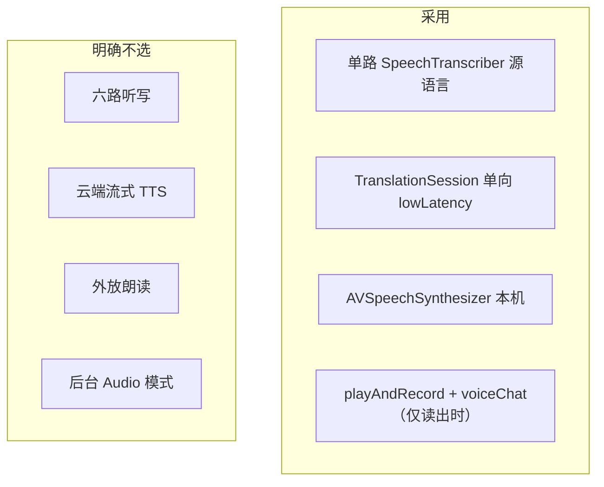

# 07 同声传译 · 技术选型

部署目标与面对面相同：**iOS 26.4+**，真机优先。
本模块在已验证的 SpeechAnalyzer + TranslationSession 之上，只新增「从句朗读」和「音频会话策略」。

---

## 1. 决策总表

| 问题 | 选择 | 不选 | 原因 |
| --- | --- | --- | --- |
| 听写路数 | 单 locale = 他说的语言 | 双路 / 自动 LID | 现场只有一个主要声源；双路会抢资源、误切 |
| 翻译 | 已有 `Translation.framework` 单向 | 云 API、端侧 LLM | 离线、无密钥、与面对面共享模型 |
| 朗读 | `AVSpeechSynthesizer` | Neural TTS 云、AudioUnit 自训 | 系统离线、六语都有声、延迟可接受 |
| 读出时机 | 从句 / 静音切句 | 每个 volatile | 同传允许耳口差；读半截词会灾难 |
| 音频会话（只字幕） | `.record` + `.measurement` | voiceChat | 与面对面一致，远场更干净 |
| 音频会话（读出） | `.playAndRecord` + `.voiceChat` | measurement + 外放 | 需要 AEC；外放会再进麦克 |
| 耳机策略 | 无耳机则禁止读出 | 软件滤回声硬刚外放 | 消费级设备滤不干净自己的喇叭 |
| UI | 独立 Feature | 在 ConversationView 分支 | 倒字板和单栏板交互相反，硬分支会腐烂 |
| 最低系统 | 不降 | iOS 18 旧 Speech | 产品已经绑在 Analyzer |

---

## 2. 语音：为什么同传用单路

面对面必须双路，因为桌上两人会换着说、语种是路由键。

同传里方向是用户选的。第二路 transcriber 的收益是「万一他说了用户的语言也能听」——但这会：

- 更容易 `insufficientResources`
- 把用户自己的插话、旁边中文议论写进字幕
- 让「他说 / 我听」语义变糊

v1 单路。若 M 里程碑里现场大量「中英夹杂演讲」，v1.1 再考虑第二路，且默认仍以源语言为准。

`SpeechDetector` 保留，用来切句和驱动朗读点。

---

## 3. 翻译：单向 Session

`preferredStrategy: .lowLatency` 已在面对面使用，同传沿用。

只锚 `source → target`。对调方向 = 换 configuration id，不要同时挂反向（省一组下载，也少一次 invalidate）。

节流数字与面对面对齐（首包 ~40 ms，之后 ~90 ms，final 必送），避免两套手感。

---

## 4. 朗读：为什么是 AVSpeechSynthesizer

| 方案 | 离线 | 延迟 | 工程 | v1 |
| --- | --- | --- | --- | --- |
| `AVSpeechSynthesizer` | 是（系统声） | 从句级，约 0.3–1 s 起读 | 低 | **采用** |
| 系统 Translation 无 TTS API | — | — | — | 不能当朗读源 |
| Foundation Models 生成后再读 | 视设备 | 高 | 高 | 否，叠加延迟 |
| 云 Neural TTS | 否 | 视网络 | 密钥 / 隐私 | 否 |

`AVSpeechSynthesisVoice(language:)` 按 `AppLanguage` 映射：

| 语言 | voice language |
| --- | --- |
| 中文 | `zh-CN` |
| English | `en-US` |
| 日本語 | `ja-JP` |
| 한국어 | `ko-KR` |
| ไทย | `th-TH` |
| Tiếng Việt | `vi-VN` |

无对应 voice → 关闭读出，字幕继续。不要静默 fallback 成英语朗读。

参数：

- `rate`：略高于 `default`（约 `0.5 * (default+max)`），同传要追上说话人
- `utterance.prefersAssistiveTechnologySettings`：尊重用户系统语速
- 不预缓存整篇，按 Clause 现说

iOS 26 上 `AVSpeechSynthesizer` 的缓冲和代理在 actor 外要用官方推荐的 main 或专用 queue 桥接，实现时包进 `SystemSpeechSynthesizer`，测试只打协议。

---

## 5. 回声：为什么禁止外放

链路：喇叭出译文 → 麦克再进 → 又识别成「他说的话」→ 再译再读。现场会振荡。

`.voiceChat` 的 AEC 对 **听筒 / 蓝牙耳机** 有效，对 **扬声器 + 桌面距离** 不可靠（面对面文档已说明不选 voiceChat 的原因：AEC 可能把对面当回声压掉）。同传读出时我们 **接受** AEC，因为此时要压的是自己的 TTS，不是桌上另一个人。

因此策略二分：

- 只字幕：measurement，尽量不处理
- 读出：voiceChat + 必须非 speaker 路由

`AVAudioSession.routeChangeNotification` 是唯一耳机真源，不要用「用户声称戴了耳机」的开关。

---

## 6. 切句与耳口差

行业里同传的 ear-voice span 常在 2–4 秒。产品上：

| 事件 | 字幕 | 朗读 |
| --- | --- | --- |
| volatile 无标点 | 更新 | 等 |
| 出现逗号/句号 | 更新 | 朗读该从句新后缀 |
| 静音 ~1100 ms | settled | 朗读剩余 |

队列上限 2：说话人加速时宁可丢旧句，也不让耳机里积压到「还在读三分钟前的内容」。

---

## 7. 模型与能力检测

启动同传前检查：

1. `SpeechTranscriber.supportedLocale(equivalentTo: source.locale)`
2. `LanguageAvailability` source → target（单向即可；反向等对调再查）
3. 若读出：对应 `AVSpeechSynthesisVoice`

缺语音/翻译模型：走现有下载 UI。缺朗读声：只禁用读出，不挡听写。

六语与面对面共用 `AppLanguage`。同传不新增语种。

---

## 8. 性能预算

按连续听 **45 分钟讲座** 设计。

| 项目 | 预算 |
| --- | --- |
| Transcriber | 1 路 + Detector |
| 翻译 | ≤ 3 次/秒，与面对面相同 |
| 朗读 | 同时 1 条 utterance |
| 历史字幕 | 内存上限 50 条，界面懒加载 |
| 音频 | 不写磁盘 |

降级顺序：关读出 → 只译 final → 提示过热请暂停。不要在同传里再叠 Foundation Models 摘要的实时调用（摘要只在暂停后手动）。

---

## 9. 隐私

与面对面相同：默认不上云、不存录音。朗读在本机合成。

读出时音频会话变为 playAndRecord，权限文案不需要新钥匙串；麦克风用途仍是「听见现场说话」。

不申请 `audio` 后台模式。

---

## 10. 与面对面技术栈的关系

| 能力 | 面对面 | 同传 |
| --- | --- | --- |
| SpeechAnalyzer | 双 Transcriber | 单 Transcriber |
| LanguageRouter | 要 | 不要（方向是偏好） |
| TranslationHost | 双向 | 单向 |
| AVSpeechSynthesizer | 无 | 有 |
| 屏幕旋转 180° | 要 | 不要 |
| 自动开始听 | 默认可 | 否 |

可移植实现：`BufferConverter`、翻译取消码、权限顺序、Tokens、`ListeningControl` 手势。

不可移植：把 `ConversationView` 的 `peerPane` 藏起来当同传——布局、路由、音频会话三条都会错。
