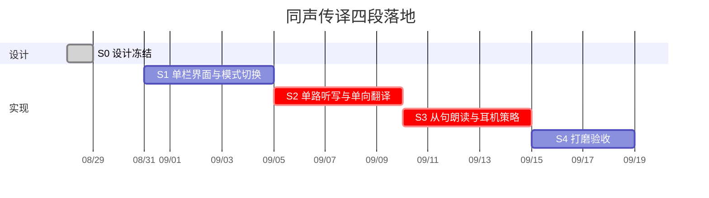

# 08 同声传译 · 落地线路图

原则：**先冻结交互，再在真机上证明「单路听写 + 单向翻译 + 耳机朗读不回灌」。** 界面可与验证平行，但 S3 过不去就不要打开读出开关给用户。

面对面 M1–M5 已在本仓库落地。同传从现有引擎和字幕板往上长，不重写 App。



一人估算约 **3 周** 到可 TestFlight 的同传 v1。

---

## 总览

| 里程碑 | 产出 | 过关标准 |
| --- | --- | --- |
| S0 设计冻结 | 05–08 文档 + HTML 原型 | 场景、禁止外放、单栏、不自动听 无异议 |
| S1 可看 | 模式切换 + 空壳主界面 | 从面对面进同传，方向条、字号、Preview 齐全 |
| S2 可译 | 单路 Analyzer + 单向 Session | 飞行模式听日语，中文大字上屏，延迟可感但可用 |
| S3 可听 | TTS + 耳机门闩 | 戴耳机能读从句；拔掉立刻停；外放无法打开读出 |
| S4 可用 | 错误、对调、摘要、测试 | 新人 20 秒开用；讲座 20 分钟不崩、不振荡 |

---

## S0 · 设计冻结（当前）

- [x] 与面对面的场景切割
- [x] 单栏原型
- [x] 架构增量（不污染 ConversationViewModel）
- [x] 技术选型：单路、单向、AVSpeechSynthesizer、禁止外放
- [x] 干系人过一遍 [`../prototype/simultaneous.html`](../prototype/simultaneous.html)

出口：方向规则不再改。之后只改实现。

---

## S1–S4 · 工程落地（已在本仓库实现）

`Features/Interpretation/`、`AudioSessionPolicy`、`SpeechSynthesizing`、单向 `TranslationHost`、ClauseSplitter 与测试已按本线路图接入。真机耳机验收仍按文末脚本执行。

---

## S1 · 单栏界面与模式切换（约 5 天）

**目标：** 没有麦克风也能演示「这是同传，不是对坐」。

任务：

1. `AppMode` + `PreferencesStore`（source / target / voiceOut / showsSourceLine / lastMode）。
2. `RootView` 按模式选择 `ConversationView` 或 `InterpretationView`；切模式先 `stop()`。
3. `InterpretationView`：顶栏、方向条、单栏字幕、复用 `ListeningControl`（swap = 对调方向）。
4. 读出开关 UI：无耳机时禁用样式（S1 可用假 `canSpeakWithoutEcho`）。
5. 设置卡片：模式切换、原文显隐、字号、清屏。
6. Preview：idle / listening / 无耳机 / failed。

验收：

- 设置里切到同声传译，屏幕不再对半倒字。
- 对调徽章动画后「他说 / 我听」对换。
- 顶栏能回到面对面。
- 进同传不自动开始听。

风险：低。

---

## S2 · 单路听写 + 单向翻译（约 5 天）

**目标：** 真机、飞行模式，现场说话出译文。

任务：

1. `start(languages: [source], fallback: source)`。
2. `InterpretationViewModel.accept` → 单向 `TranslationJob`。
3. `TranslationHostView` 只锚一对；`.id` 随方向变。
4. 换语种：停听、准备模型、回到 ready。
5. 历史 50 条封顶；live 续写规则复用 `SpokenText`。
6. 单元测试：换方向丢 live、过期翻译丢弃。

验收：

- 源日语 / 目标中文：说话后 1 秒内有 volatile 原文或占位，随后中文覆盖。
- 断网（模型已下）仍能译。
- 切回面对面，双路仍可用（回归：桌上说一句，倒字侧仍对）。

风险：中。单路已在面对面的降级路径验证过；要确认 `normalizedPair` 在只传一个语言时不会强行补上 fallback 成双路。**S2 第一天先读 `BilingualSpeechEngine.normalizedPair`，单语言必须保持单路。**

---

## S3 · 从句朗读与耳机策略（约 5 天）

**目标：** 戴耳机时译文进耳朵，不进麦克风死循环。

任务：

1. `AudioSessionPolicy` actor；两种 activate；route 监听。
2. `SpeechSynthesizing` + `SystemSpeechSynthesizer`。
3. `ClauseSplitter` + 队列上限 2 + 同一句只读后缀。
4. 无耳机 / 仅 speaker：强制 `voiceOutEnabled = false`。
5. 暂停、切模式、拔耳机：`stopAndClear`。
6. 缺 voice：禁用读出，不失败整个会话。
7. 测试：假 route、队列丢旧、后缀朗读。

验收（真机 + 有线或 AirPods）：

| 动作 | 期望 |
| --- | --- |
| 打开读出，未戴耳机 | 开关弹回，提示戴耳机，字幕仍更新 |
| 戴上后打开 | 从句级朗读，字幕继续往前 |
| 朗读中拔掉耳机 | 立即静音，听写不停 |
| 外放且强制开（调试） | 禁止；Release 无此入口 |
| 连续听 10 分钟 | 无振荡、无「自己的译文被再译一遍」 |

风险：**高**。AEC 因机型而异。缓冲：S3 过不了就把读出做成 Hidden Debug，S4 仍可只发字幕同传。

---

## S4 · 打磨与验收（约 4 天）

任务：

1. 文案六语（`Copy` 扩展），跟随「我听的语言」。
2. 暂停后「总结这次」复用 `FoundationModelsSummarizer`。
3. VoiceOver 标签、Reduce Motion、动态字体封顶。
4. 连续 20 分钟讲座：内存、发热、锁屏策略。
5. 回归面对面全部现有测试。
6. README 增加同传一节。

验收清单见文末。

---

## 依赖

```
面对面已完成
  └─ S0 文档
       └─ S1 UI 壳
            └─ S2 单路+单向译 ──┬─ S4
                 └─ S3 朗读 ────┘
```

S1 不阻塞读文档。S3 必须在 S2 真机听写稳定之后。

外部：iOS 26 真机、耳机一副、现场或播一段外语视频（手机麦克对着音箱，验收听写；读出时不要用同一音箱外放）。

---

## 明确不做（同传 v1 冻结）

- 外放 / 会议扩音
- 后台锁屏听
- 云 TTS、流式语音克隆
- 自动语种检测
- 与面对面共用一个 ViewModel
- 六路听写
- Apple Watch 遥控

v1.1 候选：中英夹杂演讲的弱双路、原文完全隐藏的专注模式、朗读语速滑条。

---

## S4 当面验收脚本

环境：飞行模式、模型已下、一副耳机、一段日语或英语讲话（1–2 分钟）。

1. 从面对面设置进入同声传译。确认没有倒字。
2. 设他说英语、我听中文。不戴耳机打开读出 → 必须失败并提示。
3. 轻点开始，播放讲话。大字为中文，底部小字为英文（若开启原文）。
4. 戴上耳机，打开读出。能听到从句，字幕不卡死。
5. 对调方向，确认要重新点开始；旧历史还在。
6. 顶栏回面对面，桌上说一句，路由与倒字仍正确。
7. 拒绝麦克风的冷启动：有「去设置」，无空白死页。

全部通过 → 同传 v1 可进 TestFlight。

---

## 实现约定

本线路图完成前 **先评原型，再写业务代码**。下一动作：过 [`../prototype/simultaneous.html`](../prototype/simultaneous.html) → 按 S1 建 `Features/Interpretation`。

编码：Swift 6、Feature 不 import Speech/AVFAudio（TranslationHost 例外与现工程相同）、PR 带 ClauseSplitter 测试 + Interpretation Preview。
