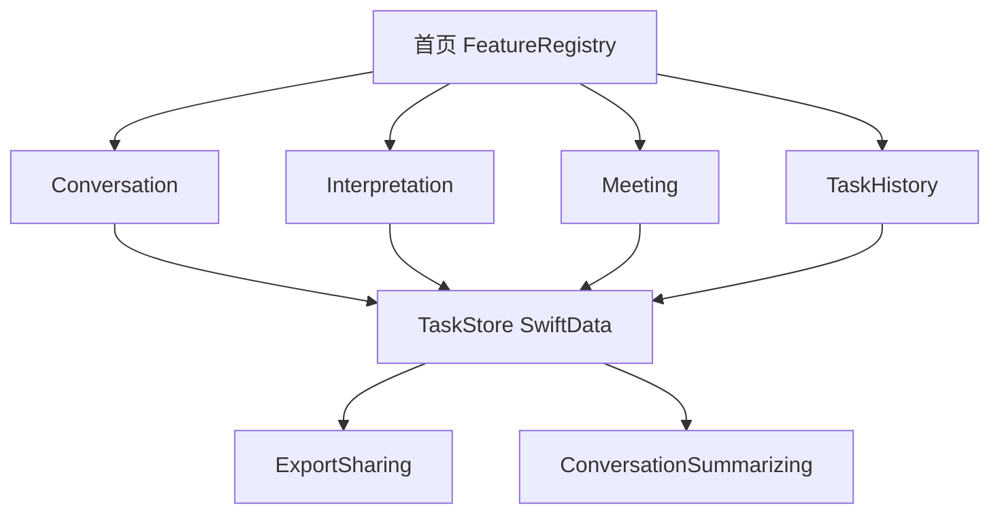

# 10 平台架构设计

目标：把对译从「两个并列界面」收成**可注册的功能平台**，在不合并面对面 / 同声传译核心逻辑的前提下，共用任务、历史、总结、语言能力。

产品规则：[`09-platform-prototype.md`](09-platform-prototype.md)
分层图：[`diagrams/platform-layers.svg`](diagrams/platform-layers.svg)
模块关系：[`diagrams/platform-modules.svg`](diagrams/platform-modules.svg)



---

## 1. 分层（相对现有工程）

单向依赖不变。Feature 仍然禁止 `import Speech` / `AVFAudio`。

```
┌─────────────────────────────────────────────┐
│  App                                        │
│  DuiyiApp · AppEnvironment · 路由 · 首页     │
├─────────────────────────────────────────────┤
│  Features                                   │
│  Home · Conversation · Interpretation       │
│  Meeting · History · Settings · Onboarding  │
├─────────────────────────────────────────────┤
│  Domain                                     │
│  FeatureID · TaskSession · LanguageCatalog  │
│  字幕 / 条款 / 路由（各模块自有模型）         │
├─────────────────────────────────────────────┤
│  Services                                   │
│  Speech · Translation · TTS · Audio         │
│  TaskStore · Summarizer · ExportSharing     │
├─────────────────────────────────────────────┤
│  DesignSystem                               │
│  Tokens · 任务条 · 历史行 · 首页卡片         │
└─────────────────────────────────────────────┘
```

| 层 | 可以 | 不可以 |
| --- | --- | --- |
| App | 组装模块、注入协议 | 写字幕合并规则 |
| Features | Domain + DesignSystem + 协议 | 直接碰 Speech / AVAudioSession / SwiftData 容器细节 |
| Domain | Foundation 模型 | SwiftUI、系统框架 API |
| Services | Domain + 系统框架 | 引用某个 Feature 的 ViewModel |
| DesignSystem | SwiftUI | 业务状态机 |

Translation 仍必须锚在 View 上（`.translationTask`）。会议记录若只转写、会后才译，同样用 `TranslationHostView`，不要在 Service 里硬持有 `TranslationSession`。

---

## 2. 模块注册：怎样加一个新功能

每个功能是一份描述 + 一个入口，而不是在 `RootView` 里再加一个 `switch`。

```swift
enum FeatureID: String, Codable, CaseIterable, Sendable {
    case faceToFace
    case simultaneous
    case meeting
}

struct FeatureDescriptor: Identifiable, Sendable {
    var id: FeatureID
    var title: (AppLanguage) -> String
    var subtitle: (AppLanguage) -> String
    var symbolName: String
    var requiredLanguages: (AppEnvironment) -> [AppLanguage]
}

@MainActor
protocol FeatureEntry {
    associatedtype Root: View
    static func makeRoot(environment: AppEnvironment, taskStore: TaskStore) -> Root
}
```

`FeatureRegistry` 只在 App 层列出当前模块。首页 `ForEach(registry.visible)` 画卡片。新模块步骤：

1. `FeatureID` 加 case  
2. 在 `Features/YourModule/` 写 View + ViewModel  
3. Registry 登记一条  
4. 若需要任务，实现 `Tasking`（见下），不要去改 ConversationViewModel  

**禁止**把同声传译逻辑 `if feature == .meeting` 塞进 `InterpretationViewModel`。

现有两个 ViewModel 保持独立：字幕路由、单向翻译、TTS 队列规则已经分叉，硬合并会回退到互相干扰。

---

## 3. 任务与存储

### 3.1 Domain

```swift
struct TaskSession: Identifiable, Equatable, Sendable {
    var id: UUID
    var feature: FeatureID
    var status: Status          // running | pausedListening | ended
    var startedAt: Date
    var endedAt: Date?
    var title: String
    var sourceLanguage: AppLanguage
    var targetLanguage: AppLanguage?   // 会议记录可空
    var entries: [TranscriptEntry]
    var summary: ConversationSummary?
}

protocol TaskStore: Sendable {
    func activeTask(for feature: FeatureID) async -> TaskSession?
    func startNew(feature: FeatureID, source: AppLanguage, target: AppLanguage?) async throws -> TaskSession
    func append(taskID: UUID, entries: [TranscriptEntry]) async
    func end(taskID: UUID, summary: ConversationSummary?) async throws -> TaskSession
    func list(filter: FeatureID?) async -> [TaskSession]
    func task(id: UUID) async -> TaskSession?
    func delete(id: UUID) async throws
}
```

进行中的任务由模块 ViewModel 持有 `taskID`。字幕仍先写内存里的 `pane` / `transcript`；**每句 settled 或暂停 / 进后台时**把条目 upsert 进 Store，避免杀进程丢整场。

结束时：`stop()` 听写 → 把内存 transcript 再刷一次 → `end`。

### 3.2 落盘

SwiftData（见 [`11-platform-tech-choices.md`](11-platform-tech-choices.md)）。Service 里一个 `SwiftDataTaskStore`，Feature 只见 `TaskStore`。

模型与 UI 模型分开：`TaskEntity` / `TranscriptEntity` 是存储；`TaskSession` 是 Domain。Store 负责映射。

不把 `PaneState` 整棵树序列化。只存 `TranscriptEntry`（源文、译文、语种、时间）。回看历史时用只读列表渲染，不复用现场 `CaptionLine` 状态机。

---

## 4. 语言目录：怎样加一种语言

现在 `AppLanguage.pick(zh:en:ja:ko:th:vi:)` 每加一种语言要改所有文案调用，扩不了。

拆成两套：

| 种类 | 用途 | 机制 |
| --- | --- | --- |
| 界面文案 | 按钮、空状态、设置 | `Localizable.xcstrings`（系统语言） |
| 现场语种 | 听写 locale、翻译对、TTS voice | `LanguageCatalog` |

```swift
struct LanguageCapability: Sendable {
    var speechLocale: String
    var translation: Locale.Language
    var ttsVoice: String
    var speech: Bool
    var translate: Bool
    var speak: Bool
}

protocol LanguageCataloging: Sendable {
    var all: [AppLanguage] { get }
    func capability(_ language: AppLanguage) -> LanguageCapability
    func speechSupported(_ language: AppLanguage) async -> Bool
    func translationPair(from: AppLanguage, to: AppLanguage) async -> TranslationPairStatus
}
```

加泰语（举例）= `AppLanguage` 新 case + Catalog 一行 + 系统模型可用性探测。首页选语种网格读 Catalog，不要写死六枚 Chip。

`Copy.swift` 里面向用户的字符串迁到 String Catalog，分阶段即可：先新页面用 Catalog，旧页面后迁。Domain 里不要 `import SwiftUI`。

---

## 5. 各 Feature 与平台的接缝

### 面对面 / 同声传译

ViewModel 增加：

- `func beginTask()` / `func endTask()`  
- 依赖 `TaskStore`  
- 现有 `accept` / `fulfill` / `scheduleSpeech` **不改语义**，只在 settled 时 `taskStore.append`

设置里的「清屏」只清现场，不问是否结束任务。结束才进历史。

### 会议记录（新）

`MeetingViewModel`：

- 单 locale `speech.start(languages: [source], fallback: source)`  
- 字幕策略：同一句修订合并成一行全文，类似同传「不堆重复」，但**不做 TTS、不做句级赶译**  
- 结束：`endTask` + 可选 `summarizer.summarize`

复用 `SpokenText` 的 continuation / refinement，不复用 `ClauseSplitter`。

### 历史

`HistoryView` + `HistoryViewModel`：只读 Store。详情页复用 `SummarySheet` 的导出能力。

### 总结与导出

```swift
protocol ExportSharing: Sendable {
    func makeTranscriptFile(task: TaskSession, language: AppLanguage) throws -> URL
}

protocol ConversationSummarizing: Sendable {
    func availability() async -> SummaryAvailability
    func summarize(entries: [TranscriptEntry], outputLanguage: AppLanguage) async throws -> ConversationSummary
}
```

`SummaryAvailability.deviceNotEligible` 必须映射到「这台 iPhone 没有 Apple 智能」，不能再用「请打开」文案。

分享在 View 层用 `ShareLink` 或 `UIActivityViewController` 分享临时 `.txt`。文件写在 Caches，分享结束可删。

---

## 6. 导航与生命周期

```
Window
  NavigationStack
    HomeView
      → ConversationView
      → InterpretationView
      → MeetingView
      → HistoryView
          → TaskDetailView
    设置：sheet
    引导：全屏 cover
```

`AppRoute` 扩展为首页 + 模块，而不是只在面对面 / 同传之间切。

`scenePhase != .active`：各模块 `stop(listening)`，**不要**自动 `endTask`。

同一时刻仍只允许一个 `SpeechRecognizing.start`。进另一模块前 `stop()`。

---

## 7. 工程结构（目标）

```
Duiyi/
  App/
    DuiyiApp.swift
    AppEnvironment.swift
    FeatureRegistry.swift
    RootView.swift              // NavigationStack + Home
  Features/
    Home/
    Conversation/               // 现有，加任务条
    Interpretation/             // 现有，加任务条
    Meeting/                    // 新建
    History/
    Settings/
    Onboarding/
    Shared/
      TaskBar.swift
      SummarySheet.swift        // 从 Conversation 上移
      ExportShareButton.swift
      TranslationHostView.swift
  Domain/
    FeatureID.swift
    TaskSession.swift
    LanguageCatalog.swift
    Models/                     // 现有字幕模型
  Services/
    Persistence/SwiftDataTaskStore.swift
    Summary/FoundationModelsSummarizer.swift
    Export/TranscriptExportService.swift
    Speech/ Translation/ Audio/ …
  DesignSystem/
    Tokens.swift
    HomeModuleCard.swift
    HistoryRow.swift
```

测试：`TaskStore` 用内存假存储；面对面 / 同传现有测试保持。会议记录补「同一句不堆行」「结束写入 Store」。

---

## 8. 编码约束（平台级）

- Swift 6，ViewModel `@MainActor`，音频 / 识别 `actor`。
- Feature 文件禁止出现 `AVSpeechSynthesizer`、`AVAudioSession`、`SpeechAnalyzer` 类型名。
- 新 UI 用系统组件：`confirmationDialog`、`swipeActions`、`ShareLink`、`NavigationStack`。
- 不在 View 里写 SwiftData `@Query` 业务规则；查询进 Store，便于测试。
- 不引入第三个状态框架（不在本阶段上 TCA）。现有 `@Observable` 已够。
