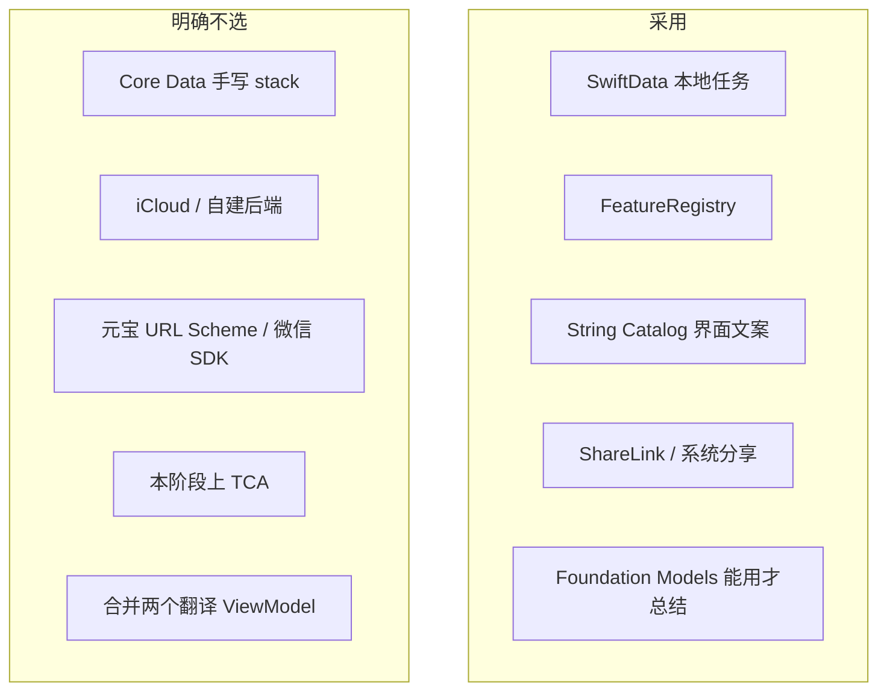

# 11 平台技术选型

部署目标：**iOS 26.4+**（与现工程一致），真机优先。
设备：能装本 App 的 iPhone；**Apple 智能不是门槛**，iPhone 13 必须完整能用（听写、翻译、任务、导出）。

---

## 1. 决策总表

| 问题 | 选择 | 不选 | 原因 |
| --- | --- | --- | --- |
| 模块怎么扩 | `FeatureID` + Registry + 独立 Feature 目录 | 在 `RootView` 无限 `switch`；合成一个超级 ViewModel | 面对面 / 同传规则已分叉；会议记录是第三种会话 |
| 任务存哪 | **SwiftData**，经 `TaskStore` 协议 | Core Data 重栈；JSON 文件手写迁移；UserDefaults | iOS 17+ 一等公民，和 Swift 6 / Codable 模型贴近；可测时换内存实现 |
| 同步 | **只本地** | CloudKit、账号 | 需求是本机历史；同步会带来隐私与冲突 |
| 界面文案 | 逐步 **String Catalog** | 继续给 `pick` 加第 7 个参数 | 扩界面语言不必改编译期函数签名 |
| 现场语种 | `AppLanguage` + `LanguageCatalog` + 系统可用性 | 写死六枚 Chip | 扩听写语言只加目录行 |
| 总结 | 现有 `FoundationModels`；按 `availability` 分支文案 | 自建云 LLM；假装 13 能开 Apple 智能 | 13 是 `deviceNotEligible`，不是用户没打开 |
| 导出 | 临时 `.txt` + **系统分享** | 深链元宝、内嵌 SDK | 元宝无稳定公开 Scheme；系统分享可点到任何 App |
| 会议听写 | 现有 `SpeechAnalyzer` **单 locale** | 六路并行；上云转写 | 与同传同一引擎，长时远场；不上云 |
| 会议是否存音 | **v1 不存** | 边录 m4a | 隐私、体积、审核；文字稿已够总结 |
| UI 框架 | SwiftUI + `@Observable` | 新模块改 UIKit | 与现工程一致；分享、导航都是系统 SwiftUI |
| 架构套件 | 保持手动协议注入 | TCA / RIBs | 三个模块体量不够本阶段引入新框架的成本 |

听写、翻译、TTS、音频会话的选型仍以 [`03-tech-choices.md`](03-tech-choices.md)、[`07-simultaneous-tech-choices.md`](07-simultaneous-tech-choices.md) 为准。本文只定平台增量。

---

## 2. 存储：为什么是 SwiftData

任务是「一条会话 + 多条字幕 + 可选摘要」，有筛选、删除、杀进程恢复。

| 方案 | 优点 | 不选的原因 |
| --- | --- | --- |
| SwiftData | 与 Swift 类型自然映射；`ModelContext` 可注入；轻量迁移 | — |
| Core Data | 成熟 | 样板多，和现有纯 Swift 模型重复一套 NSManagedObject |
| Documents 下 JSON | 实现快 | 列表查询、部分更新、损坏恢复都要自己写 |
| UserDefaults | — | 不适合长文本稿 |

实现要点：

- `ModelContainer` 只在 App 启动创建，放进 `AppEnvironment`。
- Feature 不写 `@Query`，避免视图和存储耦合、难测。
- `TranscriptEntry` 用独立实体，按 `taskID` 拉取，不要把整场会塞进一个巨大的 `Data` blob（回看和增量保存会痛）。
- 版本：`TaskEntity.schemaVersion`；v1 字段一次给齐（语种、状态、摘要、时间），少做破坏性迁移。

杀进程恢复：`status == running` 的记录在启动时列在首页「未结束的任务」，点进对应模块继续。

---

## 3. 总结：三种设备状态

`SystemLanguageModel.default.availability` 已经在 `FoundationModelsSummarizer` 里分支。产品要**对上真实原因**：

| 系统值 | 用户看到的 |
| --- | --- |
| `.available` | 生成摘要，脚注「由 Apple 智能在本机生成」 |
| `.unavailable(.appleIntelligenceNotEnabled)` | 这台机器支持，去设置打开「Apple 智能与 Siri」 |
| `.unavailable(.deviceNotEligible)` | **这台 iPhone 不能使用 Apple 智能**（iPhone 13 走这里） |
| `.unavailable(.modelNotReady)` | 模型还在准备，稍后再试；仍可导出 |
| 其他 | 现在无法在本机生成摘要，请导出后用其他工具 |

禁止再对 `deviceNotEligible` 使用当前文案「打开 Apple 智能后…」。

不在 iPhone 13 上偷偷接云 API 冒充本机总结。导出给元宝是用户主动的分享，不是 App 后台上传。

---

## 4. 导出与分享

采用系统能力，不申请额外隐私权限：

1. `TranscriptExportService` 在 Caches 写 `Duiyi-yyyyMMdd-HHmm.txt`  
2. View 用 `ShareLink(item: url)`（iOS 26 可用文件 URL）  
3. 分享 completion 后删除临时文件  

内容纯文本，UTF-8，无 HTML。文件名含模块与时间，方便掉进「文件」或元宝后还能认。

不选：

- `yuanbao://` 或其它猜测 Scheme（无官方文档，易挂）  
- 微信 / 元宝 SDK（审核、签名、与「本机工具」定位冲突）  
- 自动调用元器 HTTP API（密钥、网络、隐私协议）

---

## 5. 会议记录引擎

与同声传译相同的 `SpeechRecognizing.start(languages: [one], fallback:)`。

| 同声传译 | 会议记录 |
| --- | --- |
| 赶译 + 稳定后才 TTS | 只转写，不 TTS |
| 字幕可只保留近期 | **全文保留**（任务里的全部 settled 句） |
| 单向翻译现场出字 | v1 现场只出原文；结束可再译 |

长会风险：`SpeechAnalyzer` 长时间会话。策略：

- 与现引擎一样，流中断则 `recognitionInterrupted`，任务不自动结束，允许点开始续记（新 utterance，同一 `taskID`）。  
- 单条任务字幕上限建议 2 万字；超过提示「结束并新开一条」，避免一次 `summarize` 撑爆 Foundation Models 上下文。

---

## 6. 界面文案与语种扩展

**界面**用 String Catalog，按系统语言出「新任务」「结束任务」。这样加 App 界面语言不必改 `AppLanguage`。

**现场语种**仍是 `AppLanguage`。扩展检查清单：

1. enum case  
2. `localeIdentifier` / `speechLocaleIdentifier` / `speechVoiceLanguage`  
3. Catalog 能力（听 / 译 / 读）  
4. `LanguageAvailability` 真机探测  
5. 色板 `Tokens.languageBadge`  
6. 测试：该 locale 的 continuation 阈值（拉丁 / 非拉丁）

`pick(zh:en:…)` 保留到旧调用迁完，新代码不要再加参数。

---

## 7. 导航与系统实践

- `NavigationStack` + `navigationDestination(item:)`，不要用三个全屏 `if` 替换整个 Window 却丢返回栈。  
- 破坏性操作：`confirmationDialog`。删除历史：`swipeActions` + 确认。  
- 文件分享：`ShareLink`。拷贝摘要：`UIPasteboard` 已有则保留。  
- 后台：`scenePhase` 停听写，不停任务。  
- 权限：沿用现 Onboarding，会议记录不另要「始终录音」。  
- 无障碍：卡片 `accessibilityHint` 说明模块做什么。  
- 预览：Home / 历史空态 / 13 的总结不可用态 都要有 `#Preview`。

---

## 8. 风险

| 风险 | 缓解 |
| --- | --- |
| SwiftData 与现有纯内存 transcript 双写不一致 | 只在 settled / 暂停 / 结束 三个点 upsert；测杀进程 |
| Foundation Models 上下文不够一场长会 | 超字数截断提示；先导出再总结 |
| 首页重构打断现有进模块路径 | 先做 Home + 任务，模块内部行为冻结一周 |
| 把任务状态写进两个 ViewModel 导致分叉 | 任务状态只以 Store 为准，VM 只持 `taskID` |
