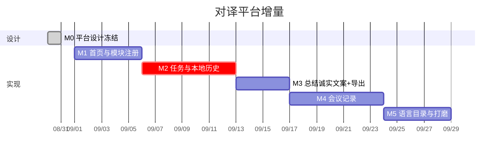

# 12 平台落地线路图

原则：**先把壳和任务存上，再动总结文案与导出，最后加会议记录。** 面对面 / 同传的字幕与朗读规则本阶段冻结，只接任务条，不重写识别。



按 1 名熟悉本仓库的 iOS 工程师估算，约 **4 周**到可在 iPhone 13 上演示：开任务、结束进历史、13 上正确提示、导出到分享、记一场会。

---

## 总览

```
W1  首页 + FeatureRegistry（仍能进面对面 / 同传）
W2  新任务 / 结束任务 + SwiftData 历史
W3  总结三态文案 + 导出分享
W4  会议记录模块 + 语言目录收口
```

| 里程碑 | 产出 | 过关标准 |
| --- | --- | --- |
| M0 | 09–12 文档 + `prototype/platform.html` | 任务语义、13 上文案、不深链元宝 无争议 |
| M1 | 首页可进三个坑位（会议可先占位） | 从首页进面对面 / 同传，听写与现在一致 |
| M2 | 任务生命周期 + 历史列表 | 结束一条，杀进程再开，历史还在 |
| M3 | 总结页按设备说话 + 分享 txt | iPhone 13 不出现「请打开 Apple 智能」 |
| M4 | 会议记录全文稿 + 结束总结 / 导出 | 一场 10 分钟会能回看、能分享 |
| M5 | Catalog 抽一层、文案与无障碍 | 加语言有检查清单；VoiceOver 能走通主路径 |

---

## 第 0 天 · 设计冻结（当前）

- [x] 平台定位与任务规则  
- [x] 架构：Registry + TaskStore，不合并两个 ViewModel  
- [x] 技术选型：SwiftData、系统分享、诚实的 Apple 智能  
- [ ] 用 [`../prototype/platform.html`](../prototype/platform.html) 点一遍：新任务、结束、历史、13 总结、会议  

出口：本阶段不再改「任务必须显式开始 / 结束」「不存录音」「不内嵌元宝」。

---

## 第 1 周前半 · M1 首页与注册

**目标：** 打开 App 先看到模块，而不是直接掉进某一种听写。

1. `FeatureID`、`FeatureDescriptor`、`FeatureRegistry`。  
2. `HomeView`：三张卡片（会议卡片可标「即将开放」若 M4 未完）。  
3. `RootView` 改为 `NavigationStack`；引导仍全屏 cover。  
4. 模块顶栏保留跳到另一模块的快捷方式，避免老用户迷路。  
5. 回归：面对面倒字、同传字幕 / 朗读现有测试全部绿。

验收：iPhone 13 从首页进同传，戴耳机听一段，行为与改前相同。

风险：导航栈与现 `AppMode` 偏好打架。处理：偏好只记「上次模块」，首页是根。

---

## 第 1 周后半–第 2 周 · M2 任务与历史

**目标：** 新任务 / 结束任务成为唯一写入历史的路径。

1. Domain `TaskSession` + `TaskStore` 协议。  
2. `SwiftDataTaskStore` + 内存 `InMemoryTaskStore`（测用）。  
3. `TaskBar`：新任务、结束任务、进行中胶囊。  
4. `ConversationViewModel` / `InterpretationViewModel` 接 `beginTask` / `endTask` / settled 时 append。  
5. `HistoryView`：列表、筛选、删除、详情只读。  
6. 未结束任务启动恢复。  
7. 测试：新任务清空现场；结束写入；短确认不影响任务边界；删除一条不影响另一条。

验收：

- 同传开任务 → 说两句 → 结束 → 历史能看到完整中文。  
- 不点新任务就听：不能听（或明确提示先开任务）。  
- 杀 App 再开，进行中的任务还在。

风险：双写 pane 与 Store。只在 settled / 暂停 / 结束刷盘。

---

## 第 3 周前半 · M3 总结与导出

**目标：** 总结页说实话，任何机器都能把字幕交出去。

1. `Copy` / 总结页按 `SummaryAvailability` 四套句子；**13 = deviceNotEligible**。  
2. `TranscriptExportService` 生成 txt。  
3. `SummarySheet` 上移到 `Features/Shared`，详情页与现场结束页共用。  
4. `ShareLink`；保留拷贝。  
5. 测试：假 Store + 假 Summarizer；eligible / notEligible 文案快照或字符串断言。

验收：iPhone 13 打开一条历史，看到「不能使用 Apple 智能」，点分享能出现系统面板，文件里有文字稿。

---

## 第 3 周后半–第 4 周 · M4 会议记录

**目标：** 第三模块真正能记一场会。

1. `Features/Meeting/` View + ViewModel。  
2. 单语听写，全文合并（复用 `SpokenText`，不用 TTS）。  
3. 结束走同一套 TaskStore + 总结 + 导出。  
4. 超长稿提示新开一条。  
5. 测试：同一句修订不堆行；结束有全文。

验收：中文会 10 分钟，回看能从头读到尾，总结（若设备支持）或导出可用。

风险：长时 `SpeechAnalyzer` 中断。中断后同一任务可续记。

---

## 第 4 周收尾 · M5 语言目录与打磨

1. `LanguageCatalog` 收口六语能力；选语种网格改为读目录。  
2. 新界面字符串进 `Localizable.xcstrings`（至少首页、任务条、历史、总结三态）。  
3. 动态字体、VoiceOver、空态、删除确认。  
4. README 改入口：先打开平台文档。  
5. 真机清单：13 上面对面 / 同传 / 历史 / 导出；若有 15 Pro 再验 Apple 智能总结。

验收：按「加语言检查清单」走一遍虚增一种语言，编译期只改 Catalog 一处 + enum，不改三个 ViewModel 的业务函数。

---

## 依赖与并行

```
M1 ──► M2 ──► M3
              └──► M4（可与 M3 末尾重叠）
                     └──► M5
```

M3 不依赖会议记录。M4 依赖 TaskStore（M2）和导出（M3 的接口可先空实现）。

不要并行「重构 Copy 全表」和「改同传合并算法」。字幕质量问题单开，不进本路线图。

---

## 本阶段不做

- iCloud、账号、录音文件  
- 元宝 / 微信 SDK  
- 合并 Conversation 与 Interpretation ViewModel  
- 会议实时同传朗读、说话人分离  
- 新的现场语种（目录先搭好，第一种新语言另开迭代）
