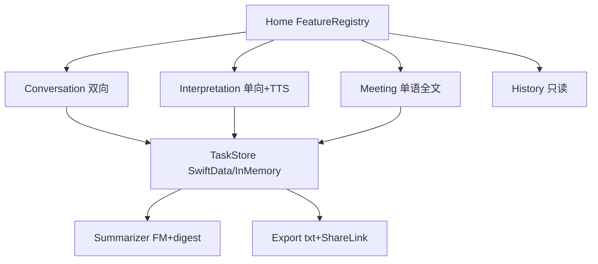

# 13 架构深度分析：技术实现原理、细节、潜在问题与优化方向

> 落盘日期：2026-09-23 · 基于代码实测（`Duiyi/` + `DuiyiTests/` + `docs/01~12` + `Duiyi.xcodeproj`）
> 部署目标：`IPHONEOS_DEPLOYMENT_TARGET = 26.4`，`SWIFT_VERSION = 6.0`，`MARKETING_VERSION = 1.0`
> 结论一句话：**分层清晰、协议注入、单向依赖的离线优先实时翻译平台；核心风险在双路 ASR 融合启发式、View 锚定的 TranslationSession 队列、单例 SpeechEngine 的多 VM 竞争、SwiftData 双写放大四处。**

---

## 0. 项目定位与体量

| 维度 | 事实 |
| --- | --- |
| 产品 | 对译 Duiyi：面对面（双屏倒字）+ 同声传译（单栏+耳机 TTS）+ 会议记录（单语全文）+ 任务历史（本机）+ 总结/导出 |
| 架构演进 | `docs/02` 面对面单体 → `docs/06` 增加 SI 模块 → `docs/10` 收成可注册功能平台（`FeatureRegistry` + `TaskStore`）。代码已落地三阶段 |
| 工程结构 | `App / Features / Domain / Services / DesignSystem`，`DuiyiTests/` 14 个测试文件 |
| 离线承诺 | SpeechAnalyzer + Translation.framework + FoundationModels（可用才用），无自建后端、无云密钥，`Info.plist` 仅麦克风+语音识别+竖屏锁定 |
| 隐私 | 默认不存音频；文本仅在 settled/暂停/结束时写入本机 SwiftData；无后台音频模式 |



---

## 1. 分层架构（实测与文档一致度高）

```
┌─────────────────────────────────────────────┐
│ App: DuiyiApp · AppEnvironment · AppCoordinator · RootView · PreferencesStore │
├─────────────────────────────────────────────┤
│ Features: Home · Conversation · Interpretation · Meeting · History · Onboarding · Shared · Settings │
├─────────────────────────────────────────────┤
│ Domain: FeatureID · TaskSession · LanguageCatalog · AppLanguage · Utterance/Clause/CaptionLine/PaneState/SpokenText · LanguageRouter · DuiyiError │
├─────────────────────────────────────────────┤
│ Services: Speech · Audio · Translation · SpeechSynthesis · Persistence · Summary · Export · Assets · Permissions │
├─────────────────────────────────────────────┤
│ DesignSystem: Tokens · HomeModuleCard · HistoryRow · ScreenSafeArea │
└─────────────────────────────────────────────┘
```

依赖规则（实测遵守较好）：

| 层 | 允许 | 禁止（实测） |
| --- | --- | --- |
| App | 组装全部、注入协议 | 写字幕合并规则（遵守） |
| Features | Domain + DesignSystem + 协议 | 直接 `import Speech/AVFAudio`（遵守，未发现越层） |
| Domain | Foundation 纯模型 | SwiftUI/系统框架（遵守，`ConversationLayout` 例外 `import CoreGraphics` 仅为 CGFloat） |
| Services | Domain + 系统框架 | 引用 Feature ViewModel（遵守） |
| DesignSystem | SwiftUI | 业务状态机（遵守） |

关键设计：

- **DI 入口**：`Duiyi/App/AppEnvironment.swift:6` `@MainActor @Observable final class AppEnvironment` 持有 11 个协议依赖，默认构造真实实现，`taskStore` 为空时 `makeTaskStore()` 建 SwiftData 容器，失败降级内存。`DuiyiApp.swift:5` 用 `@State` 持有后注入 `.environment()`。
- **导航**：`Duiyi/App/AppCoordinator.swift:5` `NavigationPath` + `AppRoute.swift:3` 五路由（conversation/interpretation/meeting/history/taskDetail）。`RootView.swift:15` `NavigationStack(path:)` + `fullScreenCover` 引导。`replaceModule/showEndedTask` 均重置栈，语义清晰。
- **模块注册**：`Duiyi/App/FeatureRegistry.swift:4` 静态三模块描述（title/subtitle 闭包按 `AppLanguage` 取文案）。新增模块按文档只需加 `FeatureID` case + Feature 目录 + 登记一行，未发现 `RootView` 无限 `switch` 之外的注册机制——`RootView.destination(for:)` 仍是 `switch`，与“不再加 switch”的理想有差距，但当前仅 3 模块可接受。
- **ViewModel 常驻**：`Duiyi/App/RootView.swift:92` `rebuildViewModelsIfNeeded()` 一次创建三 VM 常驻内存。好处是状态/任务不丢；代价是三 VM 共享同一个 `speechEngine`（见 §6.1）。

---

## 2. 核心数据流水线（全链路）


### 2.1 音频采集与会话

- `Duiyi/Services/Audio/AudioEngineCapturer.swift:5` `actor AudioEngineCapturer`：`start()` 先 `await stop()` 保证幂等，`setActive(true)`，`inputNode.installTap(bufferSize:1024)`，tap 回调内 `BufferConverter.copy()` 后 `continuation.yield`。`stop()` finish 流 + `engine.stop()` + `removeTap` + `setActive(false)`。tap 不进主线程，符合 Swift 6。
- `Duiyi/Services/Audio/BufferConverter.swift:13` `convert(_:to:)`：输入输出格式不等才建 `AVAudioConverter`（`primeMethod=.none`），按采样率比算 `frameCapacity`，单次 `convert(to:error:)` 拉取。`copy(_:)` 仅处理 `float/int16` 双分支，其他格式返回 nil（静默丢包，见 §6）。
- `Duiyi/Services/Audio/AudioSessionPolicy.swift:77` `actor AudioSessionPolicy` 是唯一应调 `setCategory` 处：
  - faceToFace / interpretationCaptions：`.record + .measurement + [.duckOthers]`
  - interpretationVoiceOut：`.playAndRecord + .default + [.duckOthers,.allowBluetoothA2DP]` + `overrideOutputAudioPort(.none)`
  - `preferPhoneMicrophone` 强制 `builtInMic/bottom` 数据源；`routeChangeNotification` 转发为 `AsyncStream<AudioRouteSnapshot>`；`AudioEchoPolicy.canSpeakWithoutEcho` 以 headphone-like 输出/输入判定能否 TTS。

### 2.2 语音识别：双路 + 降级

`Duiyi/Services/Speech/BilingualSpeechEngine.swift:5` `actor BilingualSpeechEngine`：

1. `start(languages:fallback:style:)` 先 `stop()` + `assembler.reset()`，归一化取前 2 语言，建 `AsyncStream<Utterance>` 后 `startBestPipeline`。
2. `startBestPipeline`：≥2 路试 `startDualPipeline`，`isResourceLimit`（`insufficientResources/tooManyAssetLocalesAllocated`）则逐个 drop 重试；最终 fallback 单路。`resetPipelineKeepingStream()` 只重置底层管线不 finish 外发流，保证 ViewModel 的 `for await` 不中断。
3. 双路模块：`zh_CN/en_US`（实际按传入 `AppLanguage` 解析）各一 `SpeechTranscriber(reporting:[.volatileResults,.fastResults], transcription:[.etiquetteReplacements], attribute:[.transcriptionConfidence])` + `SpeechDetector(medium, reportResults:true)`。若三模块超限，catch 后重试去掉 Detector（`BilingualSpeechEngine.swift:164`）。
4. `run(modules:)`：`bestAvailableAudioFormat` 定 analyzer 格式；meeting 用 `Options(priority:.userInitiated, retention:.whileInUse)`，live 用默认；`prepareToAnalyze` 后起 audio 转发 Task + analyzer `start(inputSequence:)` Task。转写/detector 各一消费 Task。
5. 切句：`handleTranscription` 经 `assembler.ingest` 发 `publish`；`isFinal` 则 `acknowledgeFinal(hold 1.0s)`；`handleVoiceActivity/pingSilenceTimer` 以 `ConversationLayout.silenceCommitMilliseconds=1100` 无音则 `silenceTimedOut()` 强制 final 并 `hold 0.8s`。`publish` 以 `signature(language+归一化文本)` 去重 final。
6. 单路模式语言漂移：`scheduleSingleLocaleSwitchIfNeeded` 在 final 语言≠当前单路语言时异步 `restartSingle`（reset + 切 locale），会丢一句内 volatile（文档已声明为兼容路径）。

### 2.3 UtteranceAssembler：融合核心

`Duiyi/Services/Speech/UtteranceAssembler.swift:3` 纯值 `struct`，状态：`utteranceID/texts/finals/lockedLanguage/lastLanguage/suppressOtherUntil`：

- `ingest`：空剪枝 → `matchesClaimedLanguage` 脚本门禁 → suppress 窗内异语丢弃 → locked 异语按 `shouldPreempt(challengerUnits > incumbentUnits*1.5+2)` 抢占 → 同锁下非 continuation/非 refinement 则 `beginNextUtterance` 开新句 → 更新 texts/finals → `inferredLock()` 定 winner → 返回同 `utteranceID` 的 `Utterance`（UI 原地改字）。
- `lock(texts:)`：单自信语言直接锁；多自信按 `nativeUnits` 取 max；否则 nil（`weakerGuess` 兜底单现/沿用上句）。
- 置信阈值（`isConfident`）：zh 汉字≥4；en 词≥3 且字母≥10 且越语符号<2；ja 假名≥2（或1假名+2汉字）；ko 谚文≥4；th 泰文≥4；vi 词≥2 且（越语符号≥1 或字母≥10）。短句天然不自信，配合 suppress 沿用上句，抑制“嗯/um”误切。
- `matchesClaimedLanguage` 严格：zh 要求 `han≥1 && han≥latin && kana/hangul/thai==0`；en 要求 `latin≥2 && han/kana/hangul/thai==0 && viet<2`。中英混读句会被其中一路丢弃（见 §6）。
- `silenceTimedOut/finalizeCurrentIfNeeded` 由引擎静音 Timer 或 View 触发，产 final 后 `hold` 抑制串句。

### 2.4 SpokenText / PaneState：去抖与合并

- `Duiyi/Domain/Models/SpokenText.swift:3` 纯函数库：`isContinuation`（前缀/包含/55% 共享前缀 + 语种最小茎：拉丁 16/非拉丁 6）、`isRefinement`（compact 去标点小写后前缀/包含/LCS≥82%/共享前缀≥50% 且尾差<3）、`covers/compact/normalized`、`isNameSwap/isDistinctGreeting`（hello/hey/你好等茎+名字不同则判独立问候，避免“嗨 Jack/嗨 Lucy”合并）、`preferredSource/preferredTranslation`（长者胜 + covers/refinement 仲裁）、`shouldReplaceScheduledSpeech`、`collapseStutteredRepeats`（仅非拉丁 2~4 字叠词去重，如“你们你们”）。
- `Duiyi/Domain/Models/CaptionLine.swift:50` `PaneState{history,live,speakingHint}`：`applyLive` 按 id 或 `shouldMerge(continuation/refinement)` 合并，否则 `archiveLive`；`applyTranslation` 分 live/history 写译文；`absorbRefinementHistory` 把 history 尾与 live 可合并者吸入 live，保证 ASR 修订不堆行。`archiveLive/trimHistory/resetCaptions` 语义单一，可测性好。

### 2.5 LanguageRouter

`Duiyi/Domain/Routing/LanguageRouter.swift:4` 三纯函数：`detected==user ? .peer : .user`；目标语言为对侧；说话侧为监听侧对立面。面对面用 side+language 双路由；同传/会议不用 side（同传固定 `.user` 侧，会议按 `resolvedLanguage` 重判）。

### 2.6 翻译：View 锚定是最大系统约束

- `Duiyi/Features/Conversation/TranslationHostView.swift:4` `TranslationHostView`（双向）+ `OneWayTranslationHostView`（单向）+ `TranslationPrepareHost`：`Color.clear 0×0` 常驻 + `.translationTask(config)`。config 为 `TranslationSession.Configuration(source:target:preferredStrategy:.lowLatency)`，View 的 `.id("zh-en")` 随语言对重建 session。
- `TranslationJobBridge.swift:129` `NSLock + AsyncStream + pending(1)`：`submit(job)` 按 source 分流到对应方向队列；`pump` 串行 `session.translate(text)` 后 MainActor 回调 `onSuccess/onFailure`。取消码 `TranslationErrorDomain 14/20` 与 `CancellationError` 视为过期丢弃（`ConversationViewModel.swift:622`）。
- 节流（`ConversationViewModel.swift:431`，SI 复用同阈值）：空剪枝；同 id 同文本非 final 去重；`shouldFlush = isFinal || endsWithClause || (isFirst && isWorthTranslating)` 直接 `outboundJob=job`，否则按 `first 40ms / 后续 90ms`（SI voiceOut 时 `25/50ms`）debounce 后发。`fulfill` 按 `canonicalID(utteranceAliases)` 找行，`lastAppliedSourceCount` 丢弃源字数倒退的过期译文。
- `TranslationPrepareHost` 在引导/换语言时 `invalidate()` 后 `prepareTranslation()` 预下载，避免对话中弹系统下载框。

### 2.7 同传 TTS 队列

`Duiyi/Domain/Models/Clause.swift:30` `ClauseSplitter` + `Duiyi/Features/Interpretation/InterpretationViewModel.swift:631`：

- `consume(translated:utteranceID:language:alreadySpoken:isSettled:)`：settled 全段可读；volatile 必须有终止符（`，。！？；、：…—,;:!?`）且长度达标（拉丁 18/非拉丁 6）才可读。`unspokenRemnants` 按前缀/stem/对齐/LCS/子序列尾多策略算未读后缀；settled 合并为一段，volatile 按标点切多 `Clause`。返回 `(clauses, spokenCursor)`。
- VM 侧：`scheduleSpeech` 仅 settled 入队（volatile 只更新字幕不读）；`speechSettleDelay=380ms` debounce 合并 ASR 尾修；`speechSlot` 按 `shouldReplaceScheduledSpeech` 复用槽位；`enqueueSpokenClauses` 过滤已读（`containsCompact` + `spokenCompactTail 280 字` + 队列内 compact 拼接）、`pendingJobs` 上限 `speechQueueLimit=10`（超限先丢短确认 ≤4 字，跟上说话人）；`pumpSpeech` 串行 `await synthesizer.speak`，`speechGeneration` 令牌防旧任务续读。
- `Duiyi/Services/SpeechSynthesis/SystemSpeechSynthesizer.swift:4` `@MainActor NSObject + AVSpeechSynthesizerDelegate`：`speak` 按 `speechVoiceLanguage` 取 voice，`rate=Default*1.28` 上限钳制，`CheckedContinuation` 桥 `didFinish/didCancel`；`stopAndClear` 用 `.immediate` + resume 残留 continuation。`PreviewSynthesizer` 空实现供预览/测试。

### 2.8 任务与持久化

- `Duiyi/Domain/TaskSession.swift:9` `TaskSession{id,feature,status,startedAt/endedAt,title/subtitle,source/target,entries,summary}`；`TaskTitle.make` 按模块组标题（面对面 `↔`、同传 `→`、会议多语/单语）；`MeetingLayout.transcriptCharacterLimit=20_000`；`MeetingRecognition.languages` 多语时取 `[display, display.defaultPeer]`。
- `TaskStore` 协议（`TaskSession.swift:104` `@MainActor AnyObject`）：`activeTask/unfinishedTasks/startNew/append/setStatus/saveSummary/end/list/task/delete`。`TaskSessionController.swift:127` 持 `taskID` 封装 `restore/beginNew/persist/setListening/saveSummary/finish`，空稿 `finish` 自动 `delete` 不进历史。
- `SwiftDataTaskStore.swift:5`：单 `ModelContext(autosaveEnabled:true)`；`TaskEntity/TranscriptEntity` 分表（`TaskEntities.swift:5`，cascade 删除，`sortIndex` 保序，`schemaVersion=1` 预留）；`append` 按 id upsert + sortIndex 递增；`list` 仅 `ended` 倒序；`end` 补会议 subtitle。`InMemoryTaskStore.swift:4` 同语义内存实现供测试/降级。`AppEnvironment.makeTaskStore` 建容器失败静默降级内存。
- 写入点统一：settled 时 `schedulePersist(250ms debounce)`、暂停/后台 `persistNow()`、结束 `finish(entries:)` 全量再刷。现场字幕仍以内存 `pane/transcript` 为准，回看用只读列表不复用 `CaptionLine` 状态机。

### 2.9 总结、导出、权限、资源

- `FoundationModelsSummarizer.swift:4`：`availability()` 映射四态；`summarize` 空稿抛 `summaryEmpty`，可用则 `LanguageModelSession(instructions+prompt)` 生成，非空即返回 `usedAppleIntelligence:true`，异常/不可用回退 `digest`（按 speaker 分组原文/译文拼接）。三 VM 的 `requestSummary()` 共用此分支（代码重复但语义一致）。
- `TranscriptExportService.swift:4`：Caches 写 `Duiyi-<feature>-yyyyMMdd-HHmm.txt`（UTF-8 原子写），`render` 含标题/时间/方向/正文/摘要；每次导出前删全部 `Duiyi-*.txt`。
- `PermissionService.swift:5`：`currentStatus` 映射麦克风/语音识别四态；`requestAccess` 先麦后音后重查。
- `SpeechAssetPreparer.swift:5` `actor`：`isDeviceCapable` 逐语言 `supportedLocale` 探测；`prepare` 用占位 `SpeechTranscriber(preset:.progressiveTranscription)` 建 `assetInstallationRequest` 后 `downloadAndInstall`，200ms 轮询 `fractionCompleted` 回调。
- `TranslationAvailabilityService.swift:5`：双向 `LanguageAvailability.status` 合并（任一 unsupported→unsupported；双 installed→installed；否则 supported）。
- 并发：`BilingualSpeechEngine/AudioEngineCapturer/AudioSessionPolicy = actor`；三 VM + `TaskSessionController/SwiftDataTaskStore = @MainActor`；`LanguageRouter/UtteranceAssembler/SpokenText/ClauseSplitter = Sendable 值语义`；`SendablePCMBuffer(@unchecked)` 包 AV buffer 跨域。`DuiyiLog.swift:4` 六分类 `os.Logger`。
- 会话状态机：`SessionState.swift:3` `idle/preparing/ready/listening/paused/failed(DuiyiError)`，非法跳转各 VM 内忽略。`DuiyiError.swift:3` 十种 + 六语 `userMessage`，错误仅正字侧显示。
- UI：面对面 `ConversationView.swift:21` 上屏 `rotationEffect(180°)` + `accessibilityHidden`，中钮 `ListeningControl`，`ModuleChrome/TaskBar` 导航+任务条；同传单栏 live 大字 + history 倒序 + source 小字行 + `VoiceOutControl`；会议全文 `ScrollViewReader` 跟随 live；三 View 均 `idleTimerDisabled` 联动 `keepsScreenAwake`、`onDisappear/scenePhase` 停听不停任务、`confirmationDialog` 做新任务/结束二次确认。

---

## 3. 测试现状

14 测试文件覆盖 Domain 纯逻辑 + VM 策略（router/assembler/spoken/clause/speechEngine 语言归一/音频路由假 route/任务 store/摘要 digest/三 VM 行为/onboarding）。优点：协议注入使 VM 可用假引擎/假 store/假合成器测试；`PreviewSupport` 提供 listening/streaming/failed 三态预览。缺口：无真机端到端（双路资源/翻译下载/长时发热）、无性能/并发竞态测试、无 SwiftData 迁移/杀进程恢复自动化。

---

## 4. 潜在问题（按严重度排序，均有代码依据）

### P0：会丢数据或卡死主链路

1. **单例 SpeechEngine 被三常驻 VM 共享，无中央仲裁** —— `RootView.swift:38` 后台仅 `await` 依次 stop 三 VM，快速切模块/后台回前台时可能出现 A 已 `start` 而 B 的 `stop` 后到，把流掐断。`BilingualSpeechEngine.stop()` 会 `finish utteranceContinuation`，旧 `for await` 退出后 `handleStreamEnded` 可能误报 `recognitionInterrupted`（`ConversationViewModel.swift:568` 以 `isStopping`  guard 缓解，但跨 VM 的 stop/start 无全局 generation）。
2. **翻译桥仅缓存 1 个 pending + AsyncStream 无界缓冲** —— `TranslationHostView.swift:132` `pending` 单槽 + `pump` 串行 `translate`，volatile 高频时旧 job 在流缓冲积压，`fulfill` 靠 `lastAppliedSourceCount` 丢过期，但积压仍占 session 并抬高延迟。voiceOut 档 `25/50ms` 更激进。
3. **长会话 transcript 无界/截断双极端** —— Conversation `transcript` 无上限（20 分钟连说内存与 SwiftData `append` 全量重写）；Interpretation `InterpretationViewModel.swift:848` 超 `historyLimit=50` 直接 `removeFirst`，结束前早期内容已丢；Meeting 2 万字硬停（`MeetingViewModel.swift:335`）无分段续记。
4. **SwiftData 写放大** —— `schedulePersist(250ms)` + `SwiftDataTaskStore.append` 每次全量 upsert `entries`（`SwiftDataTaskStore.swift:69` 逐条比对+`save()`），长会频繁全表 save，主线程 `ModelContext` 阻塞 UI。`autosaveEnabled=true` 又叠加自动保存，重复 IO。
5. **导出清理竞态** —— `TranscriptExportService.swift:70` 每次导出删全部 `Duiyi-*.txt`，连续导出/分享未完成时可能删掉正被 `ShareLink` 读取的文件。

### P1：识别与翻译质量回退

6. **混读/短句硬丢弃** —— `matchesClaimedLanguage` 对纯度的要求（zh 必须 `han≥latin`、en 必须 `han==0`）会丢中英混句；`shouldIgnoreCrosstalk`（`ConversationViewModel.swift:545` final 后 1s 内非自信异语丢弃）会丢合法快速 code-switch。文档提及的 `NLLanguageRecognizer` 第三票未实现。
7. **单路漂移丢半句** —— `restartSingle` 全量 `resetPipelineKeepingStream + assembler.reset`，切换期间音频继续但管线重建，约丢一句，与文档一致但无用户提示。
8. **Detector 失败静默** —— `BilingualSpeechEngine.swift:263` detector 消费 Task 的 catch 仅日志，不降级提示，切句退化为纯 `isFinal`，延迟变长用户无感知。
9. **`fail(_:)` 吞因** —— `BilingualSpeechEngine.swift:321` 仅 `finish()` 不带 error，VM 统一映射 `recognitionInterrupted`，无法区分权限/资源/中断，不利于打点与恢复策略。
10. **语言对变更重建 session 抖动** —— View `.id(source-target)` 每次换语言销毁重建双 session，旧 `translationTask` 取消（14/20 忽略正确），但 `outboundJob/sentSourceText` 未清空（仅 `resetCaptions` 清），切语言后旧译文可能写入新语言行（VM `setUserLanguage` 调了 `resetCaptions` 缓解，`handlePairChange` 的 stop/start 时序仍可能漏一句）。

### P2：音频与 TTS

11. **文档与代码的会话配置漂移** —— `docs/03` 称 `allowBluetoothHFP`，实测 `AudioSessionPolicy.swift:85` faceToFace/captions 仅 `[.duckOthers]`，无蓝牙选项；`preferPhoneMicrophone` 又强制内置麦，会削弱蓝牙耳机场景，与“允许但不推荐”的产品描述不一致。
12. **`AudioEngineCapturer` 与 `AudioSessionPolicy` 双头管理 session** —— Capturer `start()` 直接 `setActive(true)` 而不设 category，依赖调用前已 `activate`；单测/异常路径下 category 未定义。两者 `setActive(false)` 重复调用虽无害但无统一 gate。
13. **TTS 与采集串扰** —— voiceOut 用 `.playAndRecord/.default` 无显式 AEC/duck 策略调优注释，`overrideOutputAudioPort(.none)` 后外放误触仍可能回灌麦克风（靠 `canSpeakWithoutEcho` 门禁缓解，但路由误判时无二次防护）。
14. **TTS 参数写死** —— `rate=Default*1.28`、`pre/postDelay=0` 无语速/音色设置，老年/嘈杂场景不可调；`hasVoice` 仅判非 nil，不预热/不处理缺 voice 时的队列残留（VM 已 `denyVoiceOut`，但文案与设置开关状态可能闪烁一次）。

### P3：持久化与恢复

15. **容器失败静默降级内存** —— `AppEnvironment.swift:51` catch 后仅日志并返回 `InMemoryTaskStore`，用户无感知，杀进程丢全部历史，误以为已保存。
16. **无迁移实现** —— `TaskEntity.schemaVersion=1` 字段存在但无 `SchemaMigrationPlan`，字段增删即崩/丢库风险。
17. **`TaskSessionController.finish` 空稿删除** —— 无字稿任务直接删（合理），但 `beginTask` 自动 `finish` 上一任务（`ConversationViewModel.swift:139`），误触“新任务”会把未结束的旧任务归档，用户仅靠 `confirmationDialog` 拦截，手势误操作仍有风险。
18. **恢复只回放文本不回放语言对** —— `restore(from:)` 重建 `transcript/pane` 但不恢复任务当时的 `source/target`，继续录会以当前偏好语言续写，同一任务内语种标签混杂。

### P4：性能与主线程

19. **LCS/compact 全在 MainActor** —— `SpokenText.isRefinement` 的 `longestCommonSubsequenceCount` 为 O(n·m)，`PaneState.applyLive/applyTranslation/absorbRefinement` 与三 VM 的 `accept/fulfill/upsert` 均在 MainActor，长句高频 volatile 下掉帧风险。`compact` 多次重复计算同一字符串。
20. **翻译 debounce 与 UI 同频** —— `outboundJob` 每次赋值触发 `TranslationHostView onChange→submit→yield`，SwiftUI 高频 diff；`CaptionTypography` 字号计算轻量但 live 文本每 volatile 全量 `Text` 重排，无增量渲染优化。
21. **`BufferConverter` 非音频格式静默 nil** —— `copy` 仅 float/int16，其他格式返回 nil 后 tap 直接 return，无计数/日志，异常机型难以排查。

### P5：国际化与目录

22. **`StaticLanguageCatalog` 为桩** —— `LanguageCatalog.swift:33` `speechSupported` 恒 true、`translationPair` 仅判 `from!=to`，真实能力探测散落在各 View 的 `speechModels.isDeviceCapable + translationAvailability.pairStatus`，加语言仍需改 `AppLanguage` + `Tokens.languageBadge` + `SpokenText` 阈值 + 测试，目录收口未完成。`Copy.pick(zh:en:ja:ko:th:vi:)` 六参遍布，加语种要改所有调用点，与 `docs/11` “不再加参数”相悖。
23. **Onboarding 自动 finish** —— `OnboardingViewModel.swift:195` 翻译预下载成功即 `finish()`（`hasCompletedOnboarding=true`，cover 自动消失），用户无“进入”确认感；失败时 `isWorking=false` 但 `shouldPrepareTranslation=false`，重试路径依赖 View 重新触发，不够显性。

---

## 5. 后续优化方向（分期、可直接排期）

### 5.1 短期（1–2 周，止血）

| # | 动作 | 收益 | 触点 |
| --- | --- | --- | --- |
| S1 | 引入 `SpeechSessionGate`（App 层 actor，持 generation + owner FeatureID，`request(owner:)` 自动停旧主） | 根治 §4.1 双开竞争 | `AppEnvironment` + 三 VM `start/stop` |
| S2 | 翻译队列合并：Bridge 改为“每 utteranceID 只保最新”，`pump` 取最新后清空同 id 积压；voiceOut 档 debounce 回到 `40/90ms` 或按 session 繁忙自适应 | 降延迟、防积压 | `TranslationHostView.swift:129` + `ConversationViewModel.swift:431` |
| S3 | 语言切换清空翻译态：`applyDirectionChange/setUserLanguage/handlePairChange` 统一 `outboundJob=nil + translationDebounce.cancel + sentSourceText/lastApplied.clear` | 防串语言 | 三 VM + 三 View |
| S4 | SwiftData 增量落盘：`append` 只传增量（settled 新行），`schedulePersist` 合并为“脏 id 集合”批量刷；关 `autosaveEnabled` 或显式 `save` 二选一 | 降主线程卡顿与 IO | `SwiftDataTaskStore.swift:69` + 三 VM `schedulePersist` |
| S5 | 导出不删正在分享文件：按 `taskID+时间` 唯一命名 + 仅清 7 天前；分享 completion 后删 | 防分享失败 | `TranscriptExportService.swift:62` |
| S6 | 容器降级显性化：`makeTaskStore` 失败弹横幅/打点 + 历史页空态提示“本机存储不可用” | 防静默丢数据 | `AppEnvironment.swift:45` |
| S7 | 音频配置对齐文档：faceToFace 补 `allowBluetoothHFP` 或文档改“仅内置麦”；Capturer 不再直调 `setActive`，统一走 `AudioSessionPolicy` | 蓝牙可预期 | `AudioSessionPolicy.swift:81` + `AudioEngineCapturer.swift:13` |
| S8 | `copy` 不支持格式加计数日志；`fail` 透出 `DuiyiError` 给 VM（至少区分 resource/中断） | 可观测性 | `BufferConverter.swift:48` + `BilingualSpeechEngine.swift:321` |

### 5.2 中期（3–6 周，提质）

- **抽公共 CaptionPipeline**：三 VM 的 `accept/upsert/persist/requestSummary/controlLabel/idleTimer` 约 60% 重复，下沉为 `CaptionTaskController`（持 TaskSessionController + transcript + persist 调度），各 VM 只留路由/TTS/语言策略。先加协议不改行为，再逐 VM 迁移，配套现有 VM 测试锁定。
- **ASR 融合可解释化**：混句不丢弃而是按 `resolvedLanguage` 重判（会议已用，面对面可借鉴）；短句 crosstalk 窗从固定 1s 改为按语种置信动态；补 `NLLanguageRecognizer` 第三票实验开关 + 真机 AB 日志（仅本机统计，不上传）。
- **MainActor 减负**：`SpokenText.compact/isRefinement/LCS` 下沉后台（`Sendable` 纯函数已具备条件），VM 先算后回主线程写 pane；`compact` 结果随 `CaptionLine` 缓存，避免同句反复归一化。
- **长会话分段**：Conversation/Interpretation transcript 按条数/字数分页（内存只留近期 pane + 全量 Store），历史详情页分页加载；Meeting 超 2 万字自动“结束并新开续集任务”（同组 ID 关联），而非硬停。
- **语言目录成真**：`StaticLanguageCatalog` 改为缓存型探测（启动/切语言时 `speechSupported/translationPair` 真查并缓存），`LanguageChipGrid` 读目录；`Copy.pick` 冻结，新文案走 `Localizable.xcstrings`，老调用分批迁移。
- **SwiftData 迁移与后台上下文**：加 `SchemaMigrationPlan`（v1→v2 演练一次）；写操作移至后台 `ModelContext`，读经主上下文，VM 只见 `TaskStore` 不变。
- **TTS 可调与回声闭环**：语速档（0.9/1.0/1.28）+ 试听；voiceOut 时麦克风增益/duck 参数真机调优记录；拔耳机已 `confirmHeadphonesLost(300ms)`，补“外放误开拦截”二次确认。

### 5.3 长期（6 周+，扩能）

- 说话人分离/声纹标签（需 iOS 新 API 或端侧模型，先做技术 spike，不承诺 v1）。
- 会议分块总结（超上下文按时间窗 map-reduce 再总述，解决长会撑爆 FM 上下文）。
- 可选 iCloud 同步（默认关，显式 opt-in，冲突以本机为准；隐私文案先行）。
- 质量评估 harness：固定音频夹具（中英混读/远场/噪声）跑 WER/路由准确率/端到端延迟，CI 真机夜跑，替代当前“人耳验收”。
- 无障碍与老龄化：更大字号档、TTS 复述原文、VoiceOver 全路径走通。

---

## 6. 附：关键文件索引（精读顺序）

1. `Duiyi/App/AppEnvironment.swift:6` · `Duiyi/App/RootView.swift:3` · `Duiyi/App/AppCoordinator.swift:5` · `Duiyi/App/FeatureRegistry.swift:4`
2. `Duiyi/Services/Speech/BilingualSpeechEngine.swift:5` · `Duiyi/Services/Speech/UtteranceAssembler.swift:3` · `Duiyi/Services/Audio/AudioEngineCapturer.swift:5` · `Duiyi/Services/Audio/AudioSessionPolicy.swift:77` · `Duiyi/Services/Audio/BufferConverter.swift:13`
3. `Duiyi/Features/Conversation/ConversationViewModel.swift:309` `accept` · `Duiyi/Features/Interpretation/InterpretationViewModel.swift:372,631` · `Duiyi/Features/Meeting/MeetingViewModel.swift:286`
4. `Duiyi/Features/Conversation/TranslationHostView.swift:4` · `Duiyi/Domain/Models/Clause.swift:30` · `Duiyi/Domain/Models/SpokenText.swift:3` · `Duiyi/Domain/Models/CaptionLine.swift:50` · `Duiyi/Domain/Routing/LanguageRouter.swift:3`
5. `Duiyi/Domain/TaskSession.swift:9` · `Duiyi/Services/Persistence/SwiftDataTaskStore.swift:5` · `Duiyi/Services/Persistence/TaskEntities.swift:5` · `Duiyi/Services/Summary/FoundationModelsSummarizer.swift:4` · `Duiyi/Services/Export/TranscriptExportService.swift:4`
6. `Duiyi/Domain/Models/AppLanguage.swift:3` · `Duiyi/Domain/LanguageCatalog.swift:12` · `Duiyi/Domain/Errors/DuiyiError.swift:3` · `Duiyi/App/PreferencesStore.swift:5` · `Duiyi/Features/Onboarding/OnboardingViewModel.swift:5`

> 与 `docs/02/06/10` 的一致性：分层、单向依赖、Translation 锚 View、单引擎独占三条在代码中均有对应实现；差异点已在 §4 标出（蓝牙选项、NLL 第三票、Catalog 真探测、pending 单槽四处文档未细化）。
